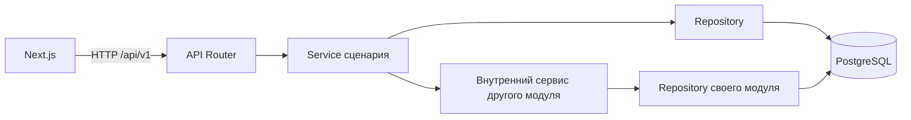

# FinanceIQ — архитектура MVP

**Статус:** архитектура MVP согласована пользователем 2026-11-02 в пакете 0.14 вместе с техническим пакетом 0.13. Этап 0 завершен; по отдельному поручению пользователя 2026-11-04 выполнен каркас backend в задаче 1.1. Остальные задачи этапа 1 остаются за границами этого поручения.

**Дата:** 2026-11-04.

**Основания:** [PRODUCT.md](PRODUCT.md), [DECISIONS.md](DECISIONS.md), [DOMAIN_MODEL.md](DOMAIN_MODEL.md), [DATABASE_SCHEMA.md](DATABASE_SCHEMA.md), [FINANCIAL_INVARIANTS.md](FINANCIAL_INVARIANTS.md), [ROADMAP.md](ROADMAP.md) и [AGENTS.md](../AGENTS.md).

## 1. Принятые основания и граница проекта

Согласованы модульный монолит, семь бизнес-модулей, общая PostgreSQL-БД, REST API `/api/v1`, серверная финансовая логика, Decimal/NUMERIC, scoped repositories и составные FK без первоначального RLS. Выбранный стек сохраняется. Продуктовые правила 0.1–0.12 находятся в профильных документах и здесь не переопределяются.

**Согласовано в 0.14 2026-11-02:** структура каталогов, внутренние контракты модулей, владение сервисной транзакцией, координация сценариев, организация процессов и применение лимитов. Они опираются на одновременно принятый технический пакет 0.13, включая корень блокировки владельца, попытки импорта и аудит. Детали Auth D-12 и прогноза D-11 сохраняют свои входные контрольные точки.

В задаче 1.1 создан устанавливаемый каркас `backend/src/financeiq` с пакетами `api`, `core`, `db`, `shared` и семью бизнес-модулями, а также каталоги `tests/unit` и `tests/integration`. Используются `venv` + `pip`, метаданные PEP 621 и backend сборки `setuptools.build_meta`; runtime-зависимостей нет. HTTP-приложение, миграции, контейнеры и CI пока отсутствуют. Дерево ниже показывает целевую структуру monorepo; остальные файлы появляются в соответствующих задачах. Целевая версия Python, версии инструментов и зависимостей, драйвер БД и библиотеки разбора выбираются в соответствующих задачах этапов 1 и 7. Детали Auth D-12 и прогноза D-11 остаются на своих входных контрольных точках (§10).

## 2. Размещение и структура monorepo

Согласован один backend в Linux-контейнере Docker Compose и одна PostgreSQL-БД. Backend запускает один API-процесс и до двух временных дочерних процессов разбора; это части одного приложения с одной версией кода. Next.js появляется на этапе 10. Взаимодействие frontend/backend проходит по HTTP; backend не обращается к себе по HTTP для вызова другого модуля.

```text
FinanceIQ/
├── backend/
│   ├── pyproject.toml
│   ├── alembic.ini
│   ├── migrations/
│   ├── src/financeiq/
│   │   ├── main.py                  # создание приложения и связывание зависимостей
│   │   ├── api/                     # общий /api/v1 router, HTTP-зависимости, ошибки
│   │   ├── core/                    # конфигурация, безопасные логи, lifecycle
│   │   ├── db/                      # engine, metadata, сессии, транзакции, блокировки
│   │   │   └── financial_actions.py # общее сохранение доказательств действий
│   │   ├── shared/                  # точные деньги, календарь, кодирование планов
│   │   └── modules/
│   │       ├── auth/
│   │       ├── accounts/
│   │       ├── transactions/
│   │       ├── categories/
│   │       ├── imports/
│   │       ├── analytics/
│   │       └── forecasting/
│   └── tests/
│       ├── unit/
│       └── integration/             # настоящая изолированная PostgreSQL
├── frontend/                       # Next.js App Router, начиная с этапа 10
│   ├── src/app/
│   ├── src/features/
│   ├── src/components/ui/
│   └── src/lib/api/generated/       # TypeScript-контракты из OpenAPI
├── contracts/openapi.json           # экспорт контракта backend после его появления
├── tests/e2e/                      # Playwright, этап 11
├── infra/                          # Dockerfiles и служебные команды хранения
├── compose.yaml
├── .env.example
├── .github/workflows/
└── docs/
```

Обычный модуль содержит `router.py`, `schemas.py`, `service.py`, `repository.py`, `models.py`, `contracts.py` и, при наличии чистых правил, `domain.py`. Файлы добавляются по необходимости: у вычисляемого результата Analytics/Forecasting нет ORM-модели ради единообразия. Специфика XLSX, supervisor разбора и очистка находятся внутри Imports. Alembic использует одну metadata и одну последовательность миграций общей схемы.

`contracts.py` содержит типизированные внутренние команды, результаты и необходимые интерфейсы зависимостей без HTTP-объектов, ORM-сущностей и создания сессии. Это локальные вызовы Python, без отдельной шины сообщений или универсального workflow-engine. `main.py` связывает реализации; дополнительные контейнеры внедрения зависимостей не требуются. `shared/` не хранит бизнес-сервисы: денежные примитивы и кодирование используются повторно, правила перевода, возврата, полноты и категорий остаются у владельцев.

## 3. Границы семи модулей

Владение таблицей означает ответственность за ее запись и контракт. Составные FK между модулями допустимы в общей БД и не дают права произвольно менять чужую таблицу.

| Модуль | Данные и правила | Публичные внутренние возможности |
| --- | --- | --- |
| Auth | `users`, `auth_sessions`; учетная запись, зона, проверка и отзыв сессии | Проверенный контекст владельца; регистрация/вход/выход и настройки зоны. Регистрация координирует создание начальных категорий |
| Accounts | `accounts`, `balance_confirmations`, `history_confirmations`; архив, опоры EOD, полнота и расчетный остаток | Проверка собственных счетов/доступности нового импорта; подтверждение/отзыв опоры и полноты; чтение покрытия и расчет остатка |
| Transactions | `transactions`, `transfer_links`, refund-ссылки; неизменяемый факт, активность, экономический тип, связи, назначение категории | Создание фактов только для принимаемого импорта; проверка/изменение классификации и связей; исключение набора при отмене; чтение фактов и кандидатов |
| Categories | `categories`, `categorization_rules`; `category_text_v1`, приоритеты, начальный набор, архив | Управление категориями/правилами; получение согласованного набора правил, чистый подбор категории и проверка допустимости назначения |
| Imports | `import_batches`, `import_attempts`, `import_account_mappings`, `import_rows`, `import_movements`, `import_cancellations`; профиль, происхождение, повторы, preview/digest и ресурсы | Upload → Parse → Validate → Preview → Confirm; координация отмены и явной новой попытки; история результата и очистка непринятого содержимого |
| Analytics | Вычисляемые показатели по периоду и счетам, эффективные категории refund, предупреждения о неполноте | Read-only проекция данных и чистый расчет по одному снимку, с явными фильтрами; без записываемых агрегатов |
| Forecasting | Базовый прогноз на 30 дней, проверка достаточности входов и объяснение ограничений | Координация чтения опор/истории и расчета; точный алгоритм и хранение результатов после решения D-11 |

Согласованные 17 таблиц схемы с условным блоком Auth распределены между первыми пятью модулями и двумя общими таблицами доказательств `financial_actions` / `financial_action_transactions`. Последние обслуживает общий persistence-компонент `db/financial_actions.py`. Смысл действия, допустимый план и before/after задает сервис текущего сценария: Imports для Confirm/отмены, Transactions для классификации/связей, Accounts для опор/полноты/архива. Общий компонент не решает финансовые правила и не образует восьмой бизнес-модуль. Это минимальный аудит D-13, не event store.

Accounts владеет смыслом отзыва полноты; при добавлении/исключении факта его обязательный эффект обеспечивает немедленный DB-механизм C-10 из пакета 0.13. Он в том же commit увеличивает `facts_version` и отзывает все затронутые интервалы со ссылкой на действие. Сервис показывает последствия и читает результат; второй независимый алгоритм отзыва после COMMIT не создается. Опоры автоматически не отзываются.

## 4. Слои и взаимодействие модулей



| Слой | Ответственность | Граница |
| --- | --- | --- |
| API Router | HTTP, Pydantic-ввод/вывод, получение проверенной сессии, вызов одного сценария, перевод безопасных ошибок | Не рассчитывает финансы, не выполняет SQL и не делает commit |
| Service | Бизнес-правила, авторизация ресурсов, актуальность плана, координация модулей и внешней границы DB-транзакции | Не зависит от Request/Response; переиспользует чистые функции, не обходит repository |
| Repository | Scoped SQLAlchemy-запросы, блокировки и сохранение данных | Не выбирает экономический смысл, не открывает независимый commit и не возвращает чужой ресурс |
| Database | NUMERIC, FK/UNIQUE/CHECK, guards, межстрочные условия и атомарность | Не доказывает человеческое согласие, корректность исходной лишней дроби или произвольного SELECT |

Чистые правила работают с Decimal, датами и типизированными значениями без БД и FastAPI. Pydantic проверяет внешние данные один раз на входе; правила, зависящие от БД, выполняет сервис после получения актуального состояния. Общие SQL-ограничения защищают обход сервисного пути, а не заменяют его. Матрица распределения проверок — [F-01–F-36](FINANCIAL_INVARIANTS.md).

Другой модуль вызывается через внутренний сервис/контракт с тем же контекстом владельца и DB-сессией. Его repository и изменяемые ORM-объекты наружу не передаются. Командные вызовы направлены от координатора к исполнителям; исполнитель не вызывает координатор обратно. Порты чтения отделены от команд: например, Accounts читает состав фактов через запрос Transactions, а Transactions проверяет счет через запрос Accounts; эти запросы не запускают встречные команды. Это устраняет рекурсивную координацию без копирования правил.

| Сценарий-координатор | Вызовы и граница |
| --- | --- |
| Auth: регистрация | Создать пользователя → Categories: создать `default_categories_v1` без правил → при предусмотренной D-12 выдаче сессии сохранить ее. Одна DB-транзакция; вход/импорт не восстанавливают набор |
| Imports: preview | Accounts: проверить mapping → Transactions: получить кандидатов → Categories: предложить категорию для новых income/expense. Нет финансовых записей |
| Imports: Confirm | Повторно построить план → Transactions: insert/link и отдельно подтвержденные финансовые связи → сохранить происхождение/доказательства/принятие; DB C-10 применяет отзыв полноты. Одна DB-транзакция |
| Imports: отмена | Повторно проверить внешние наблюдения и связи → Transactions: исключить ровно insert этого принятия и внутренние связи → сохранить отмену/доказательства; C-10 отзывает полноту. Одна DB-транзакция |
| Transactions: классификация/категория | Запросы Accounts/Categories для проверки; тип/transfer/refund и аудит сохраняются вместе. Правила не определяют экономический тип и не меняют прошлые операции автоматически |
| Accounts: остаток/полнота | Читать действующие факты через Transactions; проверить опоры/интервалы и просмотренный набор. Подтверждение полноты — отдельная команда, не побочный эффект загрузки |
| Analytics / Forecasting | Читать проекции Accounts/Transactions/Categories и применять чистые правила; Forecasting переиспользует внутренние расчеты Analytics, не HTTP endpoint |

Разрешено явное исключение для read-only проекций Analytics: его repository может выполнять scoped JOIN к таблицам Accounts, Transactions и Categories для единого отчета, включая категорию оригинала refund вне выбранного периода. Это не путь записи. Статусы активности и финансовая семантика согласованы с контрактами владельцев; скрытые копии формул не появляются в другом модуле. Accounts/Forecasting могут использовать эти проекции в уже открытом снимке.

## 5. DB-сессия, транзакции и блокировки

### 5.1. Кто делает commit

Согласована SQLAlchemy 2 AsyncSession с асинхронным драйвером, выбираемым в 1.2, и неблокирующее ожидание subprocess/IPC: supervisor должен сохранять возможность остановить обработку по deadline. Сессия создается для запроса и закрывается при любом исходе; одновременно между запросами, async-задачами или процессами не разделяется. Последовательные DB-фазы загрузки могут использовать последовательные транзакции этой сессии. Служебная порция очистки получает собственную сессию. У дочернего парсера DB-сессии и credentials отсутствуют. Внутренние вызовы финансовой команды используют сессию координатора, без собственных commit и без фоновой финансовой записи после ответа.

Внешний сервис сценария открывает транзакцию и делает единственный commit команды. Repository может делать flush, но flush не считается успехом: отложенные ограничения проверяются до успешного завершения commit. Любая ошибка, отмена запроса до commit или отказ зависимого модуля ведут к rollback всей команды; закрытие сессии само ничего не фиксирует. Ошибки commit переводятся в безопасный ответ после rollback. Ожидание загрузки, XML-разбор и пользовательское подтверждение не удерживают DB-транзакцию.

Проверка Auth не должна неявно открыть транзакцию, в которой затем пытаются сменить изоляцию отчета. Короткая проверка сессии завершается до открытия финансовой команды/read-only снимка; проверенный контекст передается явно. Точный момент проверки отзыва сессии и HTTP-контракт принимаются в D-12.

| Операция | Единица атомарности и изоляция |
| --- | --- |
| Регистрация | Пользователь и начальные категории, а также сессия, если ее создание войдет в D-12; одна write-транзакция |
| Создание/изменение счета, опоры/полноты, категории/правила, классификации/связи | Одна команда владельца в READ COMMITTED; исправление опоры = отзыв + новая запись, архив категории = архив + выключение правил, перестановка приоритетов целиком |
| Прием/разбор/подготовка preview | Файл вне БД; короткие транзакции идентичности/попытки, ограниченных порций staging и публикации плана. Пока проверка не завершена, Confirm запрещен; ни одной строки `transactions` |
| Confirm | Вся книга: действие, insert/link, происхождение, связи, отзыв полноты, неизменяемый результат, очистка raw/временного плана; один commit, без commit по строкам |
| Отмена принятия | Один конкретный принятый attempt: проверка зависимостей, отмена, исключение insert/внутренних связей, аудит и отзыв полноты; один commit |
| Очистка | Небольшая порция непринятого содержимого одного владельца с повторной проверкой состояния; свой commit, без затрагивания принятых данных |
| Остатки, аналитика, прогноз и составной preview | Один read-only REPEATABLE READ snapshot на весь результат; внутренние чтения используют ту же сессию |

### 5.2. Общий протокол записи

Согласован протокол [DATABASE_SCHEMA.md, §8](DATABASE_SCHEMA.md#8-межстрочные-ограничения-атомарность-и-конкуренция):

1. Проверить контекст владельца. Открыть write-транзакцию READ COMMITTED и отдельным SQL-запросом взять его `users FOR NO KEY UPDATE` до чтения изменяемого плана.
2. Заново определить данные и зависимости; заблокировать счета по UUID, затем batch/попытки, категории/правила, операции и связи в установленном порядке, внутри группы по UUID. Отсутствие строки/слота также защищается корнем владельца.
3. Проверить сохраненный результат повтора, затем актуальное состояние и план. Не использовать ORM-кэш или значения, прочитанные до ожидания блокировки. Не расширять подтвержденный набор автоматически.
4. Выполнить проверки и все изменения, сохранить доказательства. Проверить ограничения и завершить commit; только затем вернуть успех.

Общий helper блокировки в `db/` используется и Auth-владельцем строки users, и финансовыми сценариями; это не право финансового модуля редактировать профиль. Все пути записи, включая категории/правила, staging, слоты и очистку, соблюдают один протокол. Служебный обход выполняет отдельные транзакции по владельцам, не удерживает несколько корней. Разные пользователи независимы; чтение отчетов корень не блокирует. DB-guards берут тот же корень для защиты прямого DML согласно пакету 0.13.

После deadlock/serialization failure повторяется вся транзакция с новым чтением, а не один последний SQL. Повтор ограничен; исчерпание дает повторяемую безопасную ошибку. Изменившийся digest всегда требует нового preview и решения пользователя. При неизвестном исходе COMMIT сначала читается сохраненный результат по прежним идентификаторам; новая финансовая команда автоматически не создается.

### 5.3. Confirm и отмена

Confirm адресует конкретные `attempt_id` и серверный digest. После корня и блокировок **сначала** возвращается уже принятый результат при совпадении digest, включая отметку последующей отмены; другой digest дает конфликт. Для непринятой попытки проверяются состояние и срок по текущим серверным часам после ожидания, до первой финансовой записи. При `now >= expires_at` отказ; фиксированное время начала ожидавшей транзакции для проверки не подходит. Успевшая пройти проверку транзакция может завершиться после срока по D-09.

Затем заново проверяются весь разбор/ошибки, mapping, кандидаты и кратность, insert/link, типы, назначения категорий и отдельные согласия transfer/refund. Один и тот же код построения плана используется для preview и повторной проверки. Изменения значимого состояния требуют нового плана, а не подмены выбора. Весь результат книги, в том числе all-link с нулем новых фактов, принимается атомарно. `link` сохраняет существующий факт и категорию, сам полноту не отзывает; пустая книга не принимается.

Отмена адресует конкретный принятый attempt и digest плана отмены. Проверяются все направления внешних наблюдений/transfer/refund, включая действующие связи этого Confirm с прежними фактами. При допустимости исключается ровно набор insert, внутренние связи сохраняются отмененными, link и исходные значения остаются. Любая ошибка откатывает всю отмену. Старый повтор возвращает историю своей попытки и не меняет следующую. Новая попытка после отмены требует отдельной команды и полной загрузки без автоматического переноса решений.

План и принятые действия сохраняются по `financial_plan_v1` из [схемы, §7](DATABASE_SCHEMA.md#7-доказательства-решений-и-планы). Digest контролирует актуальность, не дает авторизацию. Версии fingerprint, нормализации категорий и финансового плана независимы; их алгоритмы не объединяются ради удобства.

## 6. Исполнение и ресурсы импорта

Численные пределы и сроки берутся только из [IMPORT_LIMITS.md, §§1–3](IMPORT_LIMITS.md#1-пределы). Ниже — согласованные в пакете 0.14 механизмы их выполнения. Значения конфигурации backend имеют один источник; фронтенд показывает полученные ограничения, а не вводит свою версию правил.

### 6.1. Допуск и прием

Один API-процесс хранит реестр занятых владельцев и два общих слота тяжелой обработки. Проверка и резервирование слота выполняются атомарно без ожидания в неограниченной очереди: максимум одна обработка владельца и две всего. Слот резервируется до приема тела и держится до публикации preview/ошибки; это также ограничивает одновременные загрузки. Просмотр уже сохраненного результата и Confirm/отмена не требуют слота разбора. На пересчет тяжелого preview действуют те же слоты и бюджет времени.

Три книги с непринятым сохраненным содержимым учитываются отдельно в PostgreSQL под корнем владельца. Учитываются разные batch, включая ошибочные и ожидающие очистки, а не число попыток. До приема проверяется доступность, после получения hash и под корнем — точная идентичность и возможность сохранить содержимое; обычный повтор существующей книги не занимает новый слот книги. Проверка перед записью не пропускается даже при свободном слоте до загрузки.

Потоковый прием начинается после проверки доступа/CSRF. Фактически прочитанные байты файла считаются до записи очередного блока, SHA-256 вычисляется по потоку, серверное имя не зависит от имени загрузки. Multipart-оболочка разбирается с ограниченным буфером; нельзя сначала целиком прочитать тело штатным обработчиком и только потом проверить 10 MiB. Абсолютный deadline приема — 60 секунд от начала тела; медленный поток, разрыв соединения и превышение размера прекращают прием и освобождают файл/слоты. Неполная загрузка не создает полноценный batch с выдуманным hash.

После полного приема сохраняются идентичность и попытка с `received_at`; TTL отсчитывается от этого момента, а не от окончания разбора. Файл находится в закрытом временном каталоге вне резервных копий и используется только до завершения разбора. Постоянного оригинала для повторного разбора нет.

### 6.2. Отдельный процесс и принудительная остановка

Supervisor Imports запускает отдельный процесс Python на попытку с явно ограниченным окружением без credentials. Парсер не получает сессию/секреты БД, не делает сетевых запросов и не запускает дочерние процессы. До открытия XLSX устанавливаются soft/hard `RLIMIT_AS` в 512 MiB и запрет core dump. Это предел адресного пространства всего процесса, включая интерпретатор и библиотеки, а не счетчик размера созданных объектов. Механизм доступен на Unix и зависит от ОС ([Python resource](https://docs.python.org/3/library/resource.html)); поддерживаемый вариант этого проекта — Linux-контейнер. Нативный запуск Windows без эквивалентного ограничения не считается проверенным режимом импорта.

Предел адресного пространства строже лимита одной только резидентной памяти: накладные расходы библиотек тоже расходуют бюджет. Парсер не импортирует Pandas, ML или все приложение. При невозможности установить ограничение разбор не начинается. Ошибка выделения памяти завершает попытку; supervisor останавливает процесс и запрещает публикацию неполного результата как готового preview. При реализации необходимо проверить этот способ на выбранных образе Python и библиотеке XLSX, а не считать наличие setrlimit достаточной проверкой.

Supervisor отсчитывает monotonic deadline 30 секунд **для всей** Parse → Validate → поиск кандидатов → построение/публикация плана, включая ожидания БД и IPC, без приема файла и времени пользователя. Нельзя дать каждому этапу отдельные 30 секунд. По deadline прекращаются DB-запросы/текущая staging-транзакция, дочерний процесс принудительно завершается и reap-ится, дальнейшая запись результата этой попытки блокируется. SQL statement/lock timeout ограничивается оставшимся бюджетом; проверка времени только после завершения недостаточна. Время TTL и технических событий берется из серверных часов, длительности — из monotonic clock.

Ограниченный канал передает родителю порции типизированных данных без полной копии книги. Родитель валидирует формат/attempt, сохраняет staging короткими транзакциями и не накапливает неограниченную очередь IPC. Сохраненная порция не является импортом финансов. Только после полного разбора и проверок родитель атомарно публикует состояние плана; незавершенная обработка, timeout, авария или отключение клиента не разрешают Confirm. Уже сохраненная диагностика подчиняется TTL/очистке, частичные итоги не выдаются за полный результат.

### 6.3. Проверки внутри парсера и жизненный цикл

До чтения содержимого проверяются ZIP-каталог и его число записей; заявленные размеры используются только для раннего отказа. Реально распакованные байты считаются по каждой части и суммарно. Части читаются потоком без полной распаковки на диск. XML разбирается с контролем глубины, запретом DTD/пользовательских сущностей и внешних ресурсов. Формулы не исполняются. Каждый декодированный текст проверяется до накопления всей книги; rich/shared strings не обходят пределы длины и памяти. Исходные деньги извлекаются точно, без промежуточного float.

Учитываются все непустые исходные записи трех листов, включая скрытые/ошибочные, и отдельно их движения: полный перевод — одна запись и две стороны. Проверяются физические координаты, а не произвольная граница номера строки. Поля не обрезаются и строки не пропускаются для прохождения лимита. Ошибка/превышение блокируют всю книгу по [IMPORT_ERRORS.md](IMPORT_ERRORS.md).

После любого исхода supervisor закрывает канал, завершает/ожидает worker, удаляет временный XLSX и освобождает реестр/слоты в finally. При аварии API дочерние процессы не должны продолжать обработку: процесс контейнера завершается вместе с ними. При перезапуске прерванные processing-попытки получают rejected с безопасным кодом сбоя, неполный план недоступен; новые попытки следуют согласованному порядку явного прекращения/повторной загрузки. Непринятое содержимое очищается по TTL или явному прекращению, без преждевременного удаления действующего preview. Перед новыми импортами убираются просроченное содержимое и остатки файлов. Живой worker не остается после освобождения слота.

Один API-процесс/одна реплика — условие корректности этого реестра. Рабочая конфигурация запуска не включает несколько workers или автоперезагрузку поверх активных импортов. До масштабирования потребуется общий механизм допуска; оно не разрешается скрытым изменением числа workers. Это техническое ограничение MVP, не введение Redis/Celery или отдельного сервиса.

## 7. Очистка и резервные копии

Imports запускает один управляемый lifecycle-процесс очистки в том же backend. До открытия приема новых импортов он убирает остатки временных файлов и недействующее непринятое содержимое после простоя. Затем планирует порции так, чтобы при штатной работе срок удаления из D-09 не превышал час после истечения/прекращения; один таймер раз в час без учета длительности очереди этой гарантии не дает. Ошибки повторяются и фиксируются без исходных значений; shutdown завершает текущую порцию либо откатывает ее.

Каждая порция берет корень владельца, затем batch/попытку по общему порядку, заново проверяет время, состояние и финансовые ссылки. Удаляются только непринятые временные дочерние данные; минимальная идентичность сохраняется. Confirm и очистка не могут принять/удалить один набор независимо. У принятого результата raw/временный план очищаются при Confirm после сохранения нормализованного происхождения и accepted_plan; подтвержденная или отмененная история не удаляется по TTL. Истечение закрывает чтение/Confirm независимо от задержки очистки.

Резервное копирование — служебная команда инфраструктуры с отдельными правами и внешним для HTTP-запроса расписанием, а не бизнес-модуль. В MVP требуется согласованная копия всей БД каждые 24 часа, шифрование, хранение семь суток и удаление просроченной копии в течение часа по [IMPORT_LIMITS.md, §4](IMPORT_LIMITS.md#4-резервные-копии). Временные каталоги/XLSX исключены. Копии не создаются этим заданием; конкретные команды, хранилище и процедура восстановления проверяются в отдельных задачах ROADMAP. Ключи и credentials не хранятся в репозитории.

Восстановление до открытия доступа требует очистки по текущему времени и проверки согласованности фактов, происхождения и результатов. Возможная потеря новых данных относительно копии не скрывается. Полное удаление учетной записи и защита от восстановления удаленного требуют отдельной согласованной процедуры; очистка preview такой процедурой не является.

## 8. Расчеты, HTTP и frontend

Accounts, Analytics и Forecasting строят ответ по одному read-only REPEATABLE READ снимку: факты, активность, связи, категории, опоры и полнота не читаются в разных транзакциях внутри одного результата. После извлечения согласованных входов чистый расчет может завершаться вне БД; внутренний сервис не открывает новый снимок. Финансовые суммы считает PostgreSQL/Decimal; Pandas не переводит денежные колонки в float. Общие правила денег и календаря используются повторно.

Архивные счета сохраняют историю и участие в общих расчетах. Текущие запросы исключают отмененные факты/связи и отозванные подтверждения. Переводы не становятся доходом/расходом при фильтрации части счетов; refund учитывается на своей дате и наследует категорию по принятому правилу. Отсутствие опоры/полноты не заменяется нулем. Аналитика по загруженным операциям раскрывает ограничение; прогноз не обещает гарантированный результат. Детальные формулы остаются в PRODUCT/DOMAIN_MODEL, открытые детали D-11 здесь не принимаются.

API использует Pydantic и версию `/api/v1`. Денежные значения передаются точными десятичными строками, финансовые дни — ISO DATE, технические моменты — с часовым поясом. Конкретные endpoints, коды ошибок, пагинация и HTTP/CSRF-контракт фиксируются в этапах 3 и профильных модулей; этот документ не создает неописанные endpoints. OpenAPI экспортируется из backend и служит источником TypeScript-контрактов; CI позднее проверяет их актуальность.

Next.js App Router отвечает за представление, TanStack Query — за серверные данные, React Hook Form/Zod — за удобство ввода, Recharts — за графики. Frontend не подключается к БД и не содержит отдельной реализации финансовых правил в client/server actions. Даже при серверном рендеринге он обращается к REST API. Преобразование в число для координат графика не используется для денежных итогов или точного отображения суммы.

После успешного изменения инвалидируются затронутые операции, импорты, счета/остатки, аналитика и прогноз; при выходе/смене пользователя пользовательский cache очищается. Отображение результата повтора Confirm сохраняет первоначальный результат и отдельно показывает отмену. Loading/empty/error, устаревший preview и неизвестный исход COMMIT имеют явные состояния. Backend не вводит кэш финансовых итогов, который скрывал бы commit или отзыв полноты.

## 9. Изоляция и безопасность

Auth предоставляет проверенный owner context из серверной отзываемой сессии. Ни user_id из тела, ни digest, ни UUID не подтверждают доступ. Все repository-запросы, списки, JOIN, агрегаты и изменения ограничены владельцем; у ссылок дополнительно проверяется нужный счет/attempt. Чужой ID не раскрывает существование ресурса. Составные FK дополняют серверные проверки записи, не защищают произвольный SELECT. RLS первоначально не используется по D-03.

Cookie защищена HttpOnly, сервер проверяет CSRF для изменяющих запросов, включая загрузку и Confirm. Режим Secure/SameSite, origins, выдача CSRF и параметры сессии принимаются в D-12, без придумывания значений по умолчанию. Сырые токены не сохраняются. Runtime-роль БД отделена от роли миграций, не владеет схемой и не может отключать guards/делать TRUNCATE. Служебная очистка имеет только необходимые права; доступ к копиям отделен от HTTP-приложения.

В технические логи не попадают XLSX, комментарии, суммы, реквизиты, причины пользователя, планы, cookie/CSRF, SQL-параметры или credentials. Доступны безопасные коды ошибок и технические идентификаторы/длительности. Pydantic/DB-ошибки проходят общий фильтр: их input/SQL не выдаются клиенту или в лог. Пользовательская диагностика исходных строк доступна только владельцу в пределах действующего preview. Интеграционные тесты двух пользователей проверяют чтение и запись во всех модулях, включая проекции и историю отмен.

## 10. Проверка проекта и контрольные точки

Для документа 0.14 выполнена сверка с пакетами 0.1–0.13: распределение семи модулей и таблиц, отсутствие самостоятельных commit внутренних сервисов, протокол блокировок/повторов/TTL, границы очистки, resource budgets и открытые решения. Машинные проверки текста и ссылок фиксируются в результате задачи; это не запуск приложения.

К будущей проверке на выбранных версиях Python/PostgreSQL относятся:

| Сценарий | Проверяемый результат и этап |
| --- | --- |
| Ошибка последней операции/отложенного ограничения Confirm или отмены | Откатывается весь сценарий, включая аудит и полноту; этапы 2/7, F-18/F-28 и S-01/S-07 |
| Два refund, два Confirm, отмена против внешнего link, архив против назначения | Общий протокол не дает нарушить инвариант; изменившийся план требует решения; этапы 2/5–7, S-05/S-08/S-11/S-12 |
| Confirm ожидает корень до истечения TTL; параллельно идет очистка | Срок проверяется после ожидания, принятые данные не очищаются; этап 7, S-09 |
| Ответ потерян после commit, затем отмена и новая попытка | Повтор возвращает старый сохраненный результат и не изменяет новый; этап 7, S-03 |
| Два разных пользователя читают/меняют свои и чужие ID | Все сервисные пути/проекции изолированы; этапы 2–9 и общая проверка 11.4 |
| Конкурентный импорт/отмена во время составного отчета | Один ответ не смешивает снимки; следующий расчет видит commit; этапы 8/9, T-32 |
| Три обработки разных владельцев и две одного владельца | Активны максимум две всего/одна владельца; лишняя получает занятость без очереди; этап 7, IMPORT_LIMITS §5 |
| Четыре книги, ошибки, ожидающая очистки и новая попытка того же batch | Корректно считаются три разных batch; этап 7, S-10 |
| Медленная загрузка, зависший XML, медленный SQL/блокировка, превышение памяти | Deadline реально прерывает работу, worker/SQL завершены, слоты/файл освобождены, неполный план не подтверждается; этап 7 |
| Превышение ZIP/XML/строк/полей и обе стороны перевода | Счетчики контролируют реальную работу; нет обрезки/частичного импорта; этап 7, IMPORT_LIMITS §5 |
| Авария, рестарт, повтор очистки и восстановление копии | Прерванные попытки закрыты, истекшие планы недоступны, история сохранена; этап 7 и отдельная процедура восстановления |
| Ошибка создания начальных категорий при регистрации | Пользователь/категории/предусмотренная сессия не сохраняются частично; этапы 3/5, CAT-12 |

Unit-тесты чистых правил, интеграционные pytest на PostgreSQL, Vitest и Playwright добавляются вместе с соответствующими модулями. Тесты прямого DML и независимых DB-сессий проверяют реальные guards/блокировки. Сценарии выше и существующая матрица — критерии будущих тестов; они не объявляются пройденными.

Технические пакеты 0.13/0.14 приняты пользователем 2026-11-02; критерии этапа 0 выполнены. Перед 2.1 уточняются поля Auth, перед этапом 3 — полный D-12, перед этапом 9 — оставшиеся детали D-11 (выбор окна, возвраты/отрицательные средние, сверка округленных сумм, качество и хранение результатов). Новых обязательных финансовых таблиц/ограничений из этих открытых предложений здесь нет. Отдельное поручение 2026-11-04 разрешает только задачу 1.1; дальнейшие задачи выполняются по отдельным поручениям. Публикация, production и деплой этим заданием не разрешаются.
