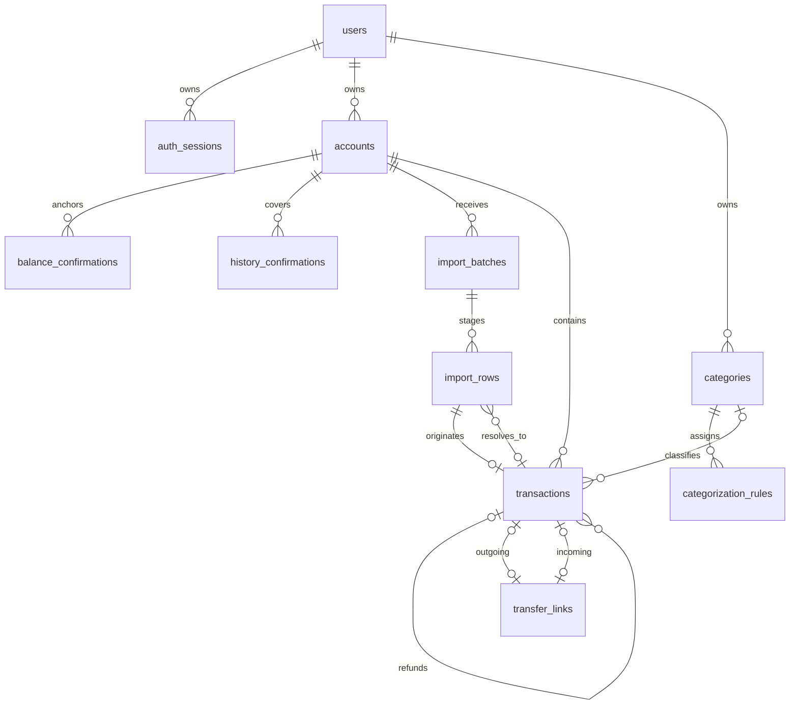

# FinanceIQ — доменная модель MVP

**Статус:** проект, частично согласован; схема в целом не утверждена.

**Дата:** 2026-10-29.

**Связанные документы:** [PRODUCT.md](PRODUCT.md), [DATABASE_SCHEMA.md](DATABASE_SCHEMA.md), [DECISIONS.md](DECISIONS.md).

## 1. Основания и границы

Основание первоначального проекта — `AGENTS.md` и `docs/PRODUCT.md` версии 1.0; ответы пользователя от 2026-10-29 отражены в `PRODUCT.md` версии 1.1 и реестре `DECISIONS.md`. `docs/ARCHITECTURE.md`, `docs/ROADMAP.md` и `README.md` отсутствуют. Утвержденный поэтапный план и дополнительные архитектурные договоренности из них не предполагаются.

Обозначения:

- **Требование** — прямо следует из `AGENTS.md` или `PRODUCT.md`.
- **Согласовано D-xx** — явно принятая пользователем часть решения от 2026-10-29 в объеме реестра [DECISIONS.md](DECISIONS.md).
- **Предложение / условный вариант D-xx** — оставшаяся часть проекта, требующая согласования. Новые поля, сущности, формулы и ограничения, которые не входят в принятый объем, сохраняют этот статус, даже если сформулированы как правило будущей реализации.

Согласованы RUB, технические подходы D-02/D-03/D-12, основное поведение переводов и указанные части времени, категорий и прогноза. Отложены возвраты (D-05), модель остатка/полноты (D-06), формат и конкретная идемпотентность импорта (D-08), лимиты/хранение (D-09). Изменение и удаление исходных фактов (D-13) отдельно не подтверждены. Согласование прогноза не утверждает эти зависимые правила.

**Требования:** Modular Monolith; модули Auth, Accounts, Transactions, Categories, Imports, Analytics, Forecasting; серверная финансовая логика; PostgreSQL и Python Decimal; одна валюта RUB; один банковский CSV-формат, пока не выбранный; прогноз на 30 дней. Реализация приложения, SQL-миграций, инфраструктуры и интерфейса в этот этап не входит.

Не проектируются банковские API, мультивалютность, PDF, ML, биллинг, what-if, микросервисы. Обязательные платежи и кредитные лимиты не выдумываются из истории. Согласованная часть перенесена в `PRODUCT.md`; оставшиеся предложения не изменяют его требования по умолчанию.

## 2. Сущности и ответственность

Ниже сохранен проект структуры, включая сущности из отложенных вопросов. В частности, `BalanceConfirmation`, `HistoryConfirmation`, модель refund и конкретные сущности импорта еще не утверждены; их присутствие в таблице и диаграмме не означает согласования.

| Модуль | Сущность | Ответственность и причина выделения |
| --- | --- | --- |
| Auth | `User` | Владелец данных, учетная запись, календарная зона. Не является общим семейным бюджетом. |
| Auth | `AuthSession` | Отзываемая серверная сессия; хранится хеш случайного токена, не cookie в открытом виде. Схема авторизации — D-12. |
| Accounts | `Account` | Собственный финансовый счет и его валюта. Не хранит изменяемый «текущий баланс». |
| Accounts | `BalanceConfirmation` | Подтвержденный пользователем остаток на конец конкретного дня. Это опорная точка, а не доход. |
| Accounts | `HistoryConfirmation` | Явное подтверждение пользователем полноты проведенных операций за интервал. Нужно отличать дни без операций от отсутствующей выписки. |
| Transactions | `Transaction` | Одно фактическое проведенное движение на одном счете. Сумма и исходные реквизиты сохраняются независимо от экономической классификации. |
| Transactions | `TransferLink` | Связывает одну или две реальные стороны внутреннего перевода. Не создает денежного движения самостоятельно. |
| Transactions | Связь `refund_of_transaction_id` | Связывает корректирующую операцию с исходным доходом или расходом. Отдельной суммы в связи нет: движение уже находится в `Transaction`. |
| Categories | `Category` | Пользовательская категория дохода или расхода. «Без категории» — отсутствие связи, а не общая изменяемая запись. |
| Categories | `CategorizationRule` | Детерминированное назначение категории. Правило не определяет само по себе, является ли движение переводом или возвратом. |
| Imports | `ImportBatch` | Один CSV для выбранного счета, версии разбора, состояние preview и факт атомарного подтверждения. |
| Imports | `ImportRow` | Строка предварительных данных, результат проверки и разрешение совпадений; после подтверждения — происхождение/сопоставление операции. |
| Analytics | `AnalyticsResult` | Вычисляемый результат по явным фильтрам. В MVP отдельной таблицы агрегатов нет. |
| Forecasting | `ForecastResult` | Вычисляемый результат, параметры и ограничения базового прогноза. Не является фактической транзакцией; сохраненные запуски не предлагаются для первого MVP. |

**Согласовано D-02:** одна общая PostgreSQL-БД, отдельные операции и связи, атомарные изменения и ограничения целостности. Запись проходит через `API Router → Service → Repository → Database`. Предлагаемая координация: Imports создает операции через внутренний сервис Transactions; финансовые правила принадлежат Transactions/Accounts и переиспользуются аналитикой. Конкретные финансовые условия отложенных решений этим не утверждаются.



У `TransferLink` обязательна хотя бы одна из двух связей. Диаграмма показывает отношения, но не заменяет ограничения из схемы. Несколько строк разных выписок могут ссылаться на одну операцию; исходная строка у операции ровно одна.

## 3. Владелец данных

**Требование:** пользователь получает доступ только к собственным счетам, операциям, категориям, импортам, правилам и прогнозам (`PRODUCT.md`, §12).

**Согласовано D-03:** изоляция через backend, scoped repositories и составные FK, включающие владельца; первоначально без RLS. Проектное представление — `user_id NOT NULL` во всех сохраняемых пользовательских сущностях и, например, `(user_id, account_id) → accounts(user_id, id)`. UUID не заменяет авторизацию.

Сервис получает владельца из проверенной сессии, игнорирует переданный клиентом `user_id`, фильтрует чтение и изменение по владельцу. Агрегации и JOIN сохраняют этот фильтр. Сопоставление импорта дополнительно ограничено счетом. Возврат может ссылаться на другой собственный счет по D-05; импортная строка не может ссылаться на операцию другого счета.

Составные FK препятствуют чужим связям при записи, но не защищают ошибочный SELECT. Для него обязательны серверная проверка и интеграционные тесты. RLS рассмотрен как альтернатива и не входит в принятый первый этап D-03.

## 4. Денежные значения и классификация

**Требование:** суммы транзакций — `NUMERIC(18,2)`; положительное значение означает поступление, отрицательное — списание. Согласованная валюта всех счетов и транзакций — RUB (`PRODUCT.md`, §6–7; D-01).

Выбор RUB не является принятием дополнительных правил нулевой суммы/лишней дроби, точности опорного остатка или конкретного состава экономических типов. Они описаны ниже как оставшийся проект D-01/D-05/D-06.

**Предложение D-01/D-06:** та же точность для подтвержденных остатков. Входные суммы читаются из строк через Decimal; значения с более чем двумя значимыми десятичными знаками отклоняются до записи, а не округляются. `1.230` допустимо как точное `1.23`; `1.231` — ошибка. `NaN`, бесконечности и нулевые операции не принимаются. Остаток может быть нулевым или отрицательным. Отрицательный остаток не моделирует кредитный лимит. При использовании Pandas денежные колонки не переводятся в float; точные суммы считаются в PostgreSQL или Decimal.

| `Transaction.kind` | Знак | Экономический смысл | Влияние на аналитику |
| --- | --- | --- | --- |
| `income` | `> 0` | Подтвержденный по смыслу внешний доход | Увеличивает доход |
| `expense` | `< 0` | Подтвержденный по смыслу внешний расход | Увеличивает расход по модулю суммы |
| `transfer` | Любой ненулевой | Подтвержденное перемещение между собственными счетами | Исключается из доходов/расходов |
| `refund` | Любой ненулевой | Положительный — возврат расхода; отрицательный — возврат/сторно дохода | Уменьшает соответствующий показатель |
| `unclassified` | Любой ненулевой | Экономический смысл еще не подтвержден | Учитывается в движении счета; отдельно раскрывается в аналитике |

Выбор `income`/`expense` не следует автоматически только из знака. Согласованный CSV-адаптер может давать классификацию по однозначным реквизитам; в остальных случаях требуется решение пользователя, до него сохраняется `unclassified`. Сигнал о возможном переводе/возврате не доказывает его тип. Категория и экономический тип — разные признаки.

**Предложение D-13:** после подтверждения импорта исходные `account_id`, `booked_on`, `amount`, `description`, банковский идентификатор и fingerprint неизменяемы. Разрешается менять экономическую классификацию, связи и категорию через сервис с повторной проверкой инвариантов. Исправление ошибочных исходных данных и удаление операций требуют отдельного процесса; универсальный CRUD финансовых фактов не включен в MVP.

## 5. Переводы

**Требование:** внутренний перевод не является доходом или расходом (`PRODUCT.md`, §7.3).

**Согласовано D-04:** одна известная сторона допустима после подтверждения пользователем принадлежности перевода собственным счетам; вторая автоматически не создается. Полная пара имеет равные противоположные суммы; комиссия отдельной строкой; несопоставленный перевод блокирует прогноз. Конкретная схема и остальные детали ниже — проектное представление этих правил.

**Предложение D-04:** перевод хранится как реальные операции на двух счетах и `TransferLink` с `outgoing_transaction_id` и `incoming_transaction_id`. Допустима одна известная сторона со статусом, вычисляемым как `unmatched`; полная пара имеет статус `matched`. Отдельное изменяемое поле статуса не хранится.

Инварианты предлагаемого варианта:

1. Все известные стороны принадлежат одному пользователю и утвержденной валюте.
2. Исходящая операция отрицательная, входящая положительная; у полной пары разные счета и суммы точно противоположны.
3. Операция с `kind = transfer` участвует ровно в одном `TransferLink`, не имеет категории и ссылки возврата.
4. Одна сторона не может одновременно участвовать в нескольких переводах. Нельзя связать операцию с собой.
5. Одна известная сторона влияет только на свой счет и исключается из доходов/расходов. Система явно показывает несопоставленный перевод, не добавляет вымышленную вторую сторону.
6. Даты двух сторон могут различаться. В период между списанием и зачислением сумма движений счетов может отличаться от внешнего денежного потока; это раскрывается отдельно.
7. Комиссия — самостоятельный `expense`. Если выписка содержит единое списание с комиссией и отдельное зачисление другой суммы, они не образуют точную пару. Разбиение одной строки на несколько операций не предлагается: требуется решение D-04.

Пример с условными данными: `-1000.00` на A и `+1000.00` на B дают нулевой доход/расход и нулевое суммарное изменение после проведения обеих сторон. Комиссия `-10.00` отдельной строкой дает расход `10.00`.

## 6. Возвраты и отмены

**Статус D-05:** обсуждение отложено пользователем. Все новые правила и примеры этого раздела остаются условным вариантом.

**Требование:** возврат нельзя автоматически считать новым доходом (`PRODUCT.md`, §7.4). Детальные правила там не утверждены.

**Предложение D-05:** `kind = refund` и необязательный `refund_of_transaction_id`. Связанный возврат указывает на исходный `income` или `expense` того же пользователя, имеет противоположный знак. Один возврат относится к одной исходной операции; частичные возвраты представлены несколькими операциями.

- Сумма модулей всех связанных возвратов не превышает модуль исходной суммы. Проверка выполняется под блокировкой исходной операции.
- Дата связанного возврата не раньше даты проведения оригинала; возврат в тот же день допустим. Иное банковское датирование требует отдельного решения, а не автоматической перестановки дат.
- Циклы и возврат возврата запрещены. Связать возврат с переводом или `unclassified` нельзя.
- Возврат может прийти на другой собственный счет. Он изменяет именно его остаток; аналитическая категория берется из исходной операции.
- У связанного возврата собственный `category_id` пуст. При изменении категории исходной операции категория возврата меняется при чтении, без копирования данных.
- У несвязанного возврата экономический смысл подтверждается отдельно пользователем; допустима ручная категория соответствующего направления. Отсутствие исходной операции раскрывается, лимит возврата в таком случае проверить нельзя.
- До выяснения смысла сомнительная операция остается `unclassified`, а не становится доходом по положительному знаку.
- Возврат учитывается на дату собственного проведения. Исторический период покупки не переписывается. В периоде только с возвратом чистые расходы или доходы могут быть отрицательными; их нельзя обрезать до нуля.
- Не проведенные банковские блокировки и отмены до проведения не являются движениями. Если выбранный CSV содержит такие записи, они блокируют подтверждение до согласования явной политики формата; молчаливого пропуска нет.
- Отмена уже проведенной операции сохраняет исходную операцию и отдельный противоположный `refund`. Полная отмена допустима только в пределах еще не возвращенной суммы. Сторно перевода требует отдельного решения; нельзя замаскировать его под обычный возврат.

Пример: расход `-100.00` в январе и возврат `+30.00` в феврале дают расходы января `100.00`, февраля `-30.00`, за оба месяца `70.00`. При возврате дохода знаки симметричны.

## 7. Подтвержденные остатки и полнота истории

**Статус D-06:** решение отложено пользователем. EOD-семантика, отдельное подтверждение полноты и его отзыв ниже не утверждены. Согласованное требование для прогноза — известные остатки всех своих счетов; их надежный источник и представление пока открыты.

**Предложение D-06/D-07:** `BalanceConfirmation(balance_date, balance)` означает остаток **после всех проведенных операций календарного дня**. Время ввода `confirmed_at` отдельно от даты остатка. Точность до дня согласуется с CSV, в котором может отсутствовать время операций.

Для счета на конец дня `D` выбирается последняя неотозванная опорная точка `d0 ≤ D`:

```text
estimated_balance(D) = confirmed_balance(d0)
                     + Σ transaction.amount, где d0 < booked_on ≤ D
```

В сумму входят все типы проведенных операций, включая переводы, возвраты и `unclassified`. Повторные строки импорта не являются новыми операциями. Операции дня `d0` уже учтены в остатке и повторно не прибавляются. Если `D = d0`, возвращается подтвержденная сумма без требования истории после нее.

Для продолжения расчета требуется покрытие **каждого дня** `(d0, D]` действующими `HistoryConfirmation`. Непрерывность определяется объединением интервалов, а не min/max дат операций. Пустая выписка может соответствовать реальному отсутствию операций, но сама по себе этого не доказывает.

Результат различает:

- `confirmed`: введенная пользователем сумма на конкретный конец дня;
- `estimated`: расчет от опорной точки и истории, полнота которой подтверждена пользователем;
- `unknown`: нет опорной точки или непрерывной истории. Можно показать движение по загруженным операциям, но не подменять им баланс.

Это сведения о проведенном остатке на конец дня. Они не доказывают доступную к трате сумму с учетом банковских блокировок, овердрафта и операций текущего незавершенного дня — отдельное согласование терминов D-06.

Дополнительные правила предлагаемого варианта:

- Будущую дату остатка/полноты подтвердить нельзя; окончание интервала — не позднее последнего завершенного дня в согласованной зоне.
- На счет и дату действует одна опорная точка. Исправление отзывает прежнюю и добавляет новую запись; история не затирается.
- Подтверждение полноты не выводится автоматически из файла или из совпадения двух остатков. Его источник в MVP — явное действие пользователя.
- Добавление новой фактической операции внутри уже подтвержденного интервала отзывает затронутые подтверждения полноты в той же DB-транзакции; нужен повторный контроль. Сопоставление строки с существующей операцией ничего не отзывает.
- Изменение категории/типа не меняет фактическое движение, но меняет аналитику и прогноз и требует перерасчета.
- Следующая опорная точка сверяется с расчетом от предыдущей при полной истории. Расхождение показывается, балансирующая транзакция не создается. Более поздняя подтвержденная точка может быть новой опорой, но не исправляет старую историю задним числом.

## 8. Идемпотентный CSV-импорт

**Статус D-08/D-09:** формат, конкретная дедупликация, лимиты и хранение отложены. Ниже сохранен вариант для последующего обсуждения, без утверждения file hash, fingerprint или конкретной процедуры Confirm.

**Требования:** `Upload → Parse → Validate → Preview → Confirm`; preview не влияет на финансы; принятый набор записывается атомарно; повтор не создает непреднамеренных дублей; совпадение даты/суммы/описания не доказывает дубль (`PRODUCT.md`, §8).

**Предложение D-08/D-09:** один batch относится к одному собственному счету и одному согласованному формату. Исходные строки хранятся отдельно от `transactions`. Подробные состояния и ограничения приведены в схеме.

Три независимых уровня защиты:

1. **Повтор файла:** SHA-256 исходных байтов в области `(user_id, account_id, format_code)`. Подтвержденный batch возвращается повторно вместе с прежним результатом; версия парсера и имя файла не создают новую идентичность файла.
2. **Банковская идентичность:** уникальный банковский ID в области пользователя, счета и стабильного пространства идентификаторов источника. Полное совпадение исходных реквизитов дает предложение связать строку с существующей операцией. Тот же ID с измененными реквизитами — конфликт, без перезаписи факта.
3. **Без банковского ID:** версионированный fingerprint исходных нормализованных даты, суммы и описания служит поиском кандидатов, **не UNIQUE**. Для коллизий/похожих операций пользователь явно выбирает `insert` или `link`. Новая строка без кандидатов может быть предложена к добавлению; решение фиксируется подтверждением preview.

Нормализация не меняет смысл: каноническая дата, десятичная строка суммы с двумя знаками, согласованное представление описания и структурированное кодирование полей перед SHA-256. Для первой версии предлагается сохранять описание без изменения регистра и внутреннего содержимого; удалять только технический BOM из файла. Версия и точные преобразования зависят от выбранного CSV. Сравниваются сами поля, а не только хеш.

Две одинаковые покупки внутри одного файла без ID сохраняют отдельные строки и могут быть приняты как две операции. Повтор одного банковского ID внутри файла блокирует подтверждение с объяснением; строка не пропускается. Вариант поддержки такого файла без внешнего исправления обсуждается в D-08.

При подтверждении сервис блокирует счет и batch, сверяет версию preview и его digest, заново проверяет владельца, кандидатов и ограничения. Если данные или правила изменились и результат больше не соответствует preview, возвращает конфликт с новым preview, не подменяет решение пользователя. Все новые операции, связи переводов, результаты строк и статус batch фиксируются одной DB-транзакцией. Ошибка откатывает весь набор.

Повтор Confirm с тем же batch и подтвержденным digest возвращает сохраненный результат. Другой digest для уже подтвержденного batch — конфликт. Сбой ответа после COMMIT не создает второй импорт. Экономическая классификация и ручная категория не входят в идентичность исходного движения.

## 9. Категоризация

**Требование:** детерминированные правила и ручное исправление (`PRODUCT.md`, §5).

**Согласовано D-10:** плоские категории доходов/расходов и правило «описание содержит текст». Побеждает первое совпадение по явному приоритету. Ручное назначение и ручное снятие категории сохраняются. Изменение правил автоматически не перекатегоризирует историю.

**Оставшееся предложение D-10:** персональные категории `income`/`expense`, уникальный положительный `priority` активных правил, меньшее число раньше, регистронезависимое сравнение с версией нормализации. Представление порядка, сравнение регистра и правила архива отдельно не согласованы; зависимость категоризации refund от D-05 также остается условной.

Правила применяются только к `income`/`expense` соответствующего направления. `transfer`, `refund` и `unclassified` автоматически не переклассифицируются. Хранятся источник категории `none/rule/manual` и использованное правило. Ручное снятие категории тоже имеет источник `manual`, чтобы правило не возвращало ее без команды пользователя.

Изменение правила не перекатегоризирует историю автоматически. Категория архивируется без разрушения исторических связей; новое назначение архивной категории запрещено. Ручные назначения не перезаписываются при повторном импорте или изменении правил.

## 10. Данные и формулы аналитики

**Статус:** условный вариант D-05/D-06/D-07/D-11. Влияние возвратов, доказательство полноты, банковская дата и часть календарных границ еще не согласованы; формулы ниже не становятся утвержденными вместе с базовым методом прогноза.

**Предложение D-11:** календарный период задается полуинтервалом `[start_date, end_date)`, список счетов — явный. Даты — `booked_on`, суммы — Decimal/NUMERIC. Для выбранного периода и счетов:

```text
income_net  = Σ amount(kind=income) + Σ amount(kind=refund AND amount<0)
expense_net = -Σ amount(kind=expense) - Σ amount(kind=refund AND amount>0)
net_cashflow = income_net - expense_net
account_movement = Σ amount(все типы)
account_movement = net_cashflow + transfer_movement + unclassified_movement
```

Последняя сверка выполняется при одинаковых фильтрах. `transfer_movement` и `unclassified_movement` — подписанные суммы. Даже когда `unclassified_movement = 0`, наличие неклассифицированных строк раскрывается: разные операции могут взаимно погаситься.

Доходы/расходы исключают переводы при любом наборе счетов; движение выбранного счета включает его сторону перевода. При фильтре по части собственных счетов внешнего дохода от перевода не появляется. Несопоставленные переводы и разные даты сторон объясняют ненулевое `transfer_movement`.

Категории суммируются с учетом возвратов на их собственную дату; связанный возврат наследует категорию оригинала даже за пределами выбранного периода/набора счетов. Не имеющие категории доходы/расходы входят в итог и отдельную группу «Без категории». `unclassified` показывается отдельно от нее. Итог по категориям равен соответствующему чистому показателю, включая отрицательные группы.

Достаточны исходные операции, связи, категории, выбранные фильтры и версия финансовых правил. Подтверждения полноты дают оценку полноты отчета; при их отсутствии аналитика по загруженным данным допустима с предупреждением. Материализованные суммы и отдельные таблицы дашборда не нужны.

## 11. Данные базового прогноза

**Требование:** горизонт 30 дней, известный `B(0)`, понятный метод и ограничения; нельзя использовать будущие факты в исторической проверке (`PRODUCT.md`, §10).

**Согласовано D-07/D-11:** средние за 30–90 полных дней, горизонт 30 дней, известные остатки всех собственных счетов; при недостаточных данных прогноз недоступен; расписания платежей пока не включаются. Пользователь выбирает часовой пояс для «сегодня» и завершенных дней; прогноз начинается после последнего завершенного дня.

**Оставшийся проект:** точный выбор окна, модель полноты/опор, чистые показатели с возвратами, дополнительные критерии качества, округление и хранение результатов ниже зависят от открытых решений. Они не утверждены ответом пользователя по прогнозу. Блокировка при несопоставленном переводе уже принята в D-04.

**Условная детализация D-11:** средние дневные чистые доходы и расходы за самый длинный общий непрерывный подтвержденный интервал, заканчивающийся `D`. Диапазон истории 30–90 полных дней согласован; выбор именно самого длинного общего интервала и способ подтверждения его полноты еще предложены. Для всех собственных счетов используется один календарный срез `D` на конец последнего завершенного дня:

```text
daily_income = income_net(history) / number_of_calendar_days
daily_expense = expense_net(history) / number_of_calendar_days
predicted_income(k) = round(k * daily_income, 2)
predicted_expense(k) = round(k * daily_expense, 2)
B(k) = B(0) + predicted_income(k) - predicted_expense(k), k = 1..30
```

Нулевые дни входят в знаменатель только при подтвержденной полноте. Предлагается округление Decimal `ROUND_HALF_UP` на выдаче кумулятивных доходов и расходов; дневные значения выводятся как разности соседних кумулятивных значений, чтобы сумма округленных дней совпадала с итогом и баланс сверялся с обоими показателями. Для исключения погрешности промежуточного деления вычисляется `round(k * total / number_of_calendar_days, 2)` с достаточной Decimal precision, без предварительного округления среднего. Отрицательные чистые средние из-за возвратов не обрезаются, их влияние поясняется.

Начальные условия: для каждого собственного счета, включая имеющий историю, но архивированный, известен остаток на общий `D`; история окна полна; нет `unclassified` и несопоставленных переводов в окне. Если счет не включается в общий прогноз, требуется отдельное утвержденное правило отбора — в этом варианте нельзя молча исключить неизвестный счет. При нарушении условий прогноз остатка недоступен с указанием причины, без `B(0)=0`.

Из источников нужны операции до `D` включительно, обе стороны переводов, возвраты, подтверждения остатков и истории. Будущие факты не используются. Зарплата и платежи не выдумываются как расписание, таблица регулярных платежей не добавляется. Модель оценивает усредненный остаток, а не конкретные даты зарплаты/аренды и не гарантированную доступность средств.

Расчет выполняется по одному согласованному DB-снимку. Результат содержит `as_of_date`, счета, опорные точки, окно, полноту, `algorithm_version`, `financial_rules_version`, параметры округления, digest исходных данных и предупреждения. Аналитика получает аналогичные фильтры и версию правил. По одинаковым данным и параметрам результат воспроизводим. Хранение исторических запусков и реконструкция состояния «как система знала тогда» не предлагаются: без версий входных данных это обещать нельзя. Историческая проверка по текущим данным называется ретроспективным расчетом, учитывает только даты `≤ D` и раскрывает поздно импортированные факты.

## 12. Проверочные сценарии для будущей реализации

Это проект приемочных сценариев; тестовый код и запуск БД на данном этапе не создаются. Сценарии для отложенных правил — условные проверки соответствующего варианта, а не утвержденные критерии приемки. Все числа ниже синтетические.

| ID | Сценарий | Ожидаемый результат / уровень проверки |
| --- | --- | --- |
| T-01 | `0.10 + 0.20`; сумма множества копеек | Ровно `0.30`; Decimal unit и PostgreSQL integration. |
| T-02 | `1.231`, `NaN`, бесконечность, нулевая операция, переполнение | Отказ до записи; для разрешенных прямых записей — DB-ограничения. `NUMERIC(18,2)` сам по себе не проверяет исходную лишнюю дробь. |
| T-03 | Доход отрицательный / расход положительный | CHECK запрещает запись. |
| T-04 | Перевод `-1000/+1000`, отдельная комиссия `-10` | Доход `0`, расход `10`, движение счетов `-10`; сумма перевода `0`. |
| T-05 | Одна сторона перевода; стороны в разных периодах | Нет фиктивной записи; предупреждение; аналитика и движение сверяются по формуле §10. |
| T-06 | Один счет с обеих сторон, неверная сумма, третий участник, повторное связывание | Транзакция БД откатывается. |
| T-07 | Расход `-100`, возвраты `+30/+70`, затем `+0.01` | Два первых разрешены; переплата запрещена. |
| T-08 | Два параллельных возврата по `+60` к `-100` | Под блокировкой допустим только один COMMIT. |
| T-09 | Возврат в следующем месяце, полный возврат дохода | Чистые метрики меняются на дату возврата, допустимы отрицательные периоды. |
| T-10 | Возврат на другом своем счете / без оригинала / к возврату / раньше оригинала | Первый разрешен; второй с предупреждением; цепочка и неверная хронология запрещены. |
| T-11 | Изменение категории оригинала; попытка изменить тип с имеющимися возвратами | Наследование категории; недопустимая переклассификация отклоняется. |
| T-12 | EOD-остаток `100` на d0; операция `+10` в d0 и `-5` в d1 | На d1 результат `95`, операция d0 повторно не добавляется. |
| T-13 | Нет остатка / пропуск дня / корректно подтвержденный пустой день | Баланс `unknown` / `unknown` / расчет разрешен. |
| T-14 | Новая поздняя операция внутри подтвержденного интервала | Полнота отозвана атомарно, старый расчет нельзя выдать без предупреждения. |
| T-15 | Разные подтвержденные остатки с расхождением | Показывается расхождение, автоматической корректировки нет. |
| T-16 | Preview без Confirm; ошибка на последней строке Confirm | Первый не влияет на финансы; второй откатывает весь принятый набор. |
| T-17 | Тот же файл с другим именем; повтор после потерянного ответа | Тот же batch и те же операции, без второго начисления. |
| T-18 | Перекрывающиеся файлы с одинаковым банковским ID | Ссылка на существующий факт; измененные реквизиты — конфликт. |
| T-19 | Две одинаковые покупки без ID; переставленные строки CSV | Никакой уникальности по fingerprint; явные решения сохраняют обе покупки или связывают повтор. |
| T-20 | Повтор банковского ID внутри файла; пустой, поврежденный, слишком большой CSV | Понятная блокирующая ошибка; финансовых записей нет. |
| T-21 | Два одновременных импорта одного счета | После сериализации кандидаты перепроверены; устаревший preview требует обновления. |
| T-22 | Confirm с измененным digest / истекший preview | Конфликт / отказ; операций нет. |
| T-23 | Пользователь B читает/меняет ID пользователя A во всех модулях | Нет доступа и утечки через ошибки; integration API и PostgreSQL. |
| T-24 | Чужой счет/категория/правило/оригинал возврата/строка импорта через SQL | Составные FK отклоняют запись. |
| T-25 | Конец месяца/года, високосный день, смена календарной зоны | Полуинтервалы не теряют и не дублируют проведенные даты. |
| T-26 | Несколько правил, ручная категория, ручное снятие категории | Первое активное правило; ручные решения не перезаписываются. |
| T-27 | Категория архивирована; повтор импорта | Историческая категория сохраняется; повтор не меняет классификацию. |
| T-28 | Аналитика части счетов и «Без категории» | Переводы не дают доход; сверка §10 и сумма категорий выполняются. |
| T-29 | Недостаточная история / неизвестный B(0) / несопоставленный перевод | Прогноз остатка недоступен с конкретной причиной. |
| T-30 | Полное окно с нулевыми днями; горизонт 30; копеечное округление | Дни учтены, 30 точек, последняя равна сумме округленных приращений. |
| T-31 | Добавить операции после исторического cutoff | Ретроспективный результат по датам не меняется; поздние факты до cutoff раскрываются отдельно. |
| T-32 | Один и тот же DB-снимок и параметры; параллельный импорт | Детерминированный результат без смешивания разных снимков. |
| T-33 | Отмена до проведения / отдельная проведенная отмена | Первая не исчезает молча из CSV; вторая сохраняет оба движения. |

Согласование модели означает выбор вариантов в `DECISIONS.md`, а не разрешение автоматически переходить к реализации следующего этапа.
