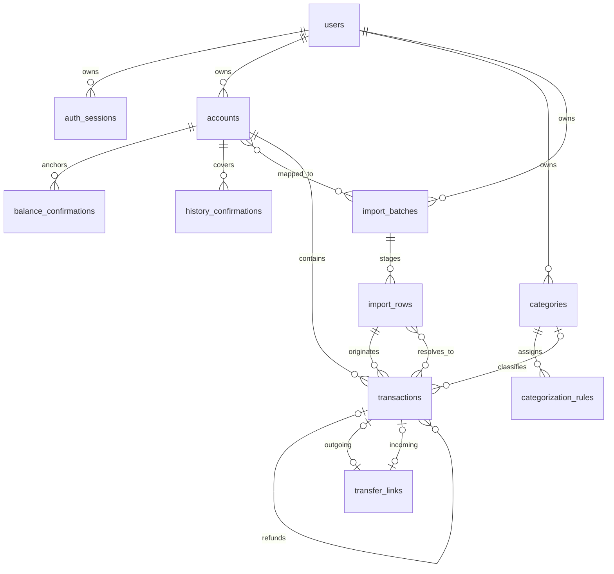

# FinanceIQ — доменная модель MVP

**Статус:** проект, частично согласован; схема в целом не утверждена.

**Дата:** 2026-10-30.

**Связанные документы:** [PRODUCT.md](PRODUCT.md), [DATABASE_SCHEMA.md](DATABASE_SCHEMA.md), [DECISIONS.md](DECISIONS.md).

## 1. Основания и границы

Основание первоначального проекта — `AGENTS.md` и `docs/PRODUCT.md` версии 1.0; ответы пользователя от 2026-10-29 и согласование D-01, D-04 (пункт 0.6), D-05, остатков из D-06 и временной основы D-07 от 2026-10-30 отражены в `PRODUCT.md` версии 1.6 и реестре `DECISIONS.md`. [README.md](../README.md) и [ROADMAP.md](ROADMAP.md) доступны; по заданию пользователя от 2026-10-30 начат этап 0 плана. `docs/ARCHITECTURE.md` пока отсутствует; его подготовка предусмотрена пунктом 0.14. Начало этапа не утверждает открытые финансовые решения, схему или дополнительные архитектурные договоренности.

Обозначения:

- **Требование** — прямо следует из `AGENTS.md` или `PRODUCT.md`.
- **Согласовано D-xx** — явно принятая пользователем часть решения в объеме реестра [DECISIONS.md](DECISIONS.md), включая согласования от 2026-10-29 и 2026-10-30.
- **Предложение / условный вариант D-xx** — оставшаяся часть проекта, требующая согласования. Новые поля, сущности, формулы и ограничения, которые не входят в принятый объем, сохраняют этот статус, даже если сформулированы как правило будущей реализации.

Согласованы денежные правила D-01, возвраты D-05, остатки/полнота/исправление D-06, пользовательская occurred_on и календарные правила D-07, технические подходы D-02/D-03/D-12, переводы и указанные части категорий/прогноза. В 0.7 принят полный профиль money_manager_xlsx_v1 и синтетический образец. Идентичность/повторы и ошибки импорта (0.8–0.9), лимиты/хранение (D-09), изменение/удаление фактов (D-13) остаются открытыми; профиль их не утверждает.

**Требования:** Modular Monolith; модули Auth, Accounts, Transactions, Categories, Imports, Analytics, Forecasting; серверная финансовая логика; PostgreSQL и Python Decimal; одна валюта RUB; один формат Money Manager XLSX вместо банковского CSV; прогноз на 30 дней. Реализация приложения, SQL-миграций, инфраструктуры и интерфейса в этот этап не входит.

Не проектируются банковские API, мультивалютность, PDF, ML, биллинг, what-if, микросервисы. Обязательные платежи и кредитные лимиты не выдумываются из истории. Согласованная часть перенесена в `PRODUCT.md`; оставшиеся предложения не изменяют его требования по умолчанию.

## 2. Сущности и ответственность

Ниже сохранен проект структуры. Продуктовые правила переводов, возвратов, опорных остатков и подтверждения полноты уже согласованы; точные поля, FK и механизмы, включая представление подтверждения/аудита и защиту от подтверждения устаревшего набора фактов, проверяются при приемке схемы в пункте 0.13. Конкретные сущности импорта пока не утверждены; их присутствие в таблице и диаграмме не означает согласования.

| Модуль | Сущность | Ответственность и причина выделения |
| --- | --- | --- |
| Auth | `User` | Владелец данных, учетная запись, календарная зона. Не является общим семейным бюджетом. |
| Auth | `AuthSession` | Отзываемая серверная сессия; хранится хеш случайного токена, не cookie в открытом виде. Схема авторизации — D-12. |
| Accounts | `Account` | Собственный финансовый счет и его валюта. Не хранит изменяемый «текущий баланс». |
| Accounts | `BalanceConfirmation` | Подтвержденный пользователем остаток на конец конкретного дня. Это опорная точка, а не доход. |
| Accounts | `HistoryConfirmation` | Явное подтверждение пользователем полноты проведенных операций за интервал. Нужно отличать дни без операций от отсутствующей выписки. |
| Transactions | `Transaction` | Одно фактическое проведенное движение на одном счете. Сумма и исходные реквизиты сохраняются независимо от экономической классификации. |
| Transactions | `TransferLink` | Связывает одну или две реальные стороны внутреннего перевода. Не создает денежного движения самостоятельно. |
| Transactions | Связь `refund_of_transaction_id` | Связывает корректирующую операцию с исходным доходом или расходом. Отдельной суммы в связи нет: движение уже находится в `Transaction`. |
| Categories | `Category` | Пользовательская категория дохода или расхода. «Без категории» — отсутствие связи, а не общая изменяемая запись. |
| Categories | `CategorizationRule` | Детерминированное назначение категории. Правило не определяет само по себе, является ли движение переводом или возвратом. |
| Imports | `ImportBatch` | Одна XLSX-книга целиком, явное сопоставление существующим собственным счетам, общий preview и атомарный Confirm всех сопоставленных счетов. |
| Imports | `ImportRow` | Исходная запись с координатой лист/строка и результатом проверки. Обычная запись задает одно движение, полная запись перевода — два с признаками сторон; физическое представление уточняется в 0.13. |
| Analytics | `AnalyticsResult` | Вычисляемый результат по явным фильтрам. В MVP отдельной таблицы агрегатов нет. |
| Forecasting | `ForecastResult` | Вычисляемый результат, параметры и ограничения базового прогноза. Не является фактической транзакцией; сохраненные запуски не предлагаются для первого MVP. |

**Согласовано D-02:** одна общая PostgreSQL-БД, отдельные операции и связи, атомарные изменения и ограничения целостности. Запись проходит через `API Router → Service → Repository → Database`. Предлагаемая координация: Imports создает операции через внутренний сервис Transactions; финансовые правила принадлежат Transactions/Accounts и переиспользуются аналитикой. Конкретные финансовые условия отложенных решений этим не утверждаются.



У `TransferLink` обязательна хотя бы одна из двух связей. Диаграмма показывает отношения, но не заменяет ограничения из схемы. Несколько строк разных выписок могут ссылаться на одну операцию; исходная строка у операции ровно одна.

## 3. Владелец данных

**Требование:** пользователь получает доступ только к собственным счетам, операциям, категориям, импортам, правилам и прогнозам (`PRODUCT.md`, §12).

**Согласовано D-03:** изоляция через backend, scoped repositories и составные FK, включающие владельца; первоначально без RLS. Проектное представление — `user_id NOT NULL` во всех сохраняемых пользовательских сущностях и, например, `(user_id, account_id) → accounts(user_id, id)`. UUID не заменяет авторизацию.

Сервис получает владельца из проверенной сессии, игнорирует переданный клиентом `user_id`, фильтрует чтение и изменение по владельцу. Агрегации и JOIN сохраняют этот фильтр. Сопоставление импорта дополнительно ограничено счетом. Возврат может ссылаться на другой собственный счет по D-05; каждое движение должно соответствовать сопоставленному счету своей исходной записи/стороны; многосчетный batch не разрешает чужие связи.

Составные FK препятствуют чужим связям при записи, но не защищают ошибочный SELECT. Для него обязательны серверная проверка и интеграционные тесты. RLS рассмотрен как альтернатива и не входит в принятый первый этап D-03.

## 4. Денежные значения и классификация

**Требование:** суммы транзакций — `NUMERIC(18,2)`; положительное значение означает поступление, отрицательное — списание. Согласованная валюта всех счетов и транзакций — RUB (`PRODUCT.md`, §6–7; D-01).

**Согласовано D-01, 2026-10-30:** нулевые фактические операции, включая `-0.00`, не принимаются; нулевые остатки и результаты допустимы. Фактические суммы читаются точно через Decimal: `1.230` принимается как `1.23`, а `1.231` отклоняется до SQL без округления. В preview ошибочная строка остается видимой. Вычисляемые денежные суммы округляются до копеек по `ROUND_HALF_UP` (`1.005 → 1.01`, `-1.005 → -1.01`) без предварительного округления промежуточных значений; точность вычислений обеспечивает правильность итогового округления. Сверка дневных и итоговых сумм прогноза остается открытой частью D-11.

**Согласовано D-06, пункт 0.4:** подтвержденный остаток имеет тип `NUMERIC(18,2)`, проверяется без округления; ноль и отрицательный остаток допустимы, кредитный лимит не прибавляется. Экономическая модель возвратов принята в D-05. Защита денежных полей от `NaN` и бесконечностей описана в проекте схемы. При использовании Pandas денежные колонки не переводятся в float; точные суммы считаются в PostgreSQL или Decimal.

**Согласовано D-07 и профилем 0.7, 2026-10-30:** occurred_on DATE — локальный пользовательский день движения Money Manager. Числовая дата/время Excel разбирается с учетом системы дат; берется календарный день без сдвига через UTC. Источник ведется в Europe/Saratov, будущие даты проверяются относительно этой зоны; корректные прошлые даты не ограничиваются произвольной глубиной. Смена пользовательской зоны не сдвигает сохраненный день. API использует [start_date, end_date), неделя начинается в понедельник, месяцы календарные. Пользовательская зона прогноза отдельно определяет «сегодня» и завершенные дни.

**Граница достоверности:** пользователь вносит запись в день движения денег; occurred_on не подтверждает банковское проведение. Опоры и полнота для остатков/прогноза проверяются по D-06. Полный контракт принят в [IMPORT_FORMAT.md](IMPORT_FORMAT.md); итоговое представление происхождения и ограничений БД сверяется в 0.13.

| `Transaction.kind` | Знак | Экономический смысл | Влияние на аналитику |
| --- | --- | --- | --- |
| `income` | `> 0` | Подтвержденный по смыслу внешний доход | Увеличивает доход |
| `expense` | `< 0` | Подтвержденный по смыслу внешний расход | Увеличивает расход по модулю суммы |
| `transfer` | Любой ненулевой | Подтвержденное перемещение между собственными счетами | Исключается из доходов/расходов |
| `refund` | Любой ненулевой | Положительный — возврат расхода; отрицательный — возврат/сторно дохода | Уменьшает соответствующий показатель |
| `unclassified` | Любой ненулевой | Экономический смысл еще не подтвержден | Учитывается в движении счета; отдельно раскрывается в аналитике |

Выбор `income`/`expense` не следует автоматически только из знака. Согласованный адаптер импорта может давать классификацию по однозначным реквизитам; в остальных случаях требуется решение пользователя, до него сохраняется `unclassified`. Для `transfer` явное подтверждение по §5 обязательно независимо от реквизитов источника. Сигнал о возможном переводе/возврате не доказывает его тип. Категория и экономический тип — разные признаки.

**Предложение D-13:** после подтверждения импорта исходные `account_id`, `occurred_on`, `amount`, `description`, банковский идентификатор и fingerprint неизменяемы. Разрешается менять экономическую классификацию, связи и категорию через сервис с повторной проверкой инвариантов. Исправление ошибочных исходных данных и удаление операций требуют отдельного процесса; универсальный CRUD финансовых фактов не включен в MVP.

## 5. Переводы

**Требование:** внутренний перевод не является доходом или расходом (`PRODUCT.md`, §7.3).

**Согласовано D-04, включая пункт 0.6 от 2026-10-30:** пользователь явно выбирает «Это перевод между моими счетами», подтверждая принадлежность обоих счетов себе. При наличии обеих загруженных операций он вручную подтверждает конкретную пару. Одну известную сторону можно подтвердить без создания второй. Сумма и дата позволяют предложить кандидатов, но не связывают операции автоматически. Несопоставленный перевод раскрывается и блокирует прогноз. Полная пара имеет равные противоположные суммы на разных собственных счетах; даты могут различаться.

**Предложение D-04:** перевод хранится как реальные операции на двух счетах и `TransferLink` с `outgoing_transaction_id` и `incoming_transaction_id`. Допустима одна известная сторона со статусом, вычисляемым как `unmatched`; полная пара имеет статус `matched`. Отдельное изменяемое поле статуса не хранится.

Инварианты предлагаемого варианта:

1. Все известные стороны принадлежат одному пользователю и утвержденной валюте.
2. Исходящая операция отрицательная, входящая положительная; у полной пары разные счета и суммы точно противоположны.
3. Операция с `kind = transfer` участвует ровно в одном `TransferLink`, не имеет категории и ссылки возврата.
4. Одна сторона не может одновременно участвовать в нескольких переводах. Нельзя связать операцию с собой.
5. Одна известная сторона влияет только на свой счет и исключается из доходов/расходов. Система явно показывает несопоставленный перевод, не добавляет вымышленную вторую сторону.
6. Даты двух сторон могут различаться. В период между списанием и зачислением сумма движений счетов может отличаться от внешнего денежного потока; это раскрывается отдельно.
7. Комиссия — самостоятельный `expense` только по отдельной операции источника. Смешанное списание со встроенной комиссией и зачисление другой суммы не образуют точную пару. Списание остается `unclassified`, поступление можно явно подтвердить как одиночный перевод. Строка не разбивается, исходная сумма не переписывается; разница не признается комиссией. Расходы помечаются неполными, прогноз недоступен с указанием причин.
8. Проведенный обратный перевод, в том числе частичный, состоит из новых реальных операций и отдельной подтвержденной пары по тем же правилам. Исходная пара сохраняется; движения учитываются на собственные даты. Одна известная обратная сторона допускается как несопоставленная и блокирует прогноз. Обратная операция на том же счете не образует пару с исходной; `refund` к переводу запрещен.

Пример с условными данными: `-1000.00` на A и `+1000.00` на B дают нулевой доход/расход и нулевое суммарное изменение после проведения обеих сторон. Комиссия `-10.00` отдельной строкой дает расход `10.00`.

При смешанном списании `-1010.00` на A и зачислении `+1000.00` на B движение счетов равно `-10.00`. Это не доказывает отдельный расход `10.00`: списание остается неклассифицированным, расходы неполны. Такое представление источника ограничивает возможности MVP; разбиение требует отдельного решения.

Техническая схема связи остается проектом. Представление явного подтверждения/аудита и защита от подтверждения устаревшего набора операций проверяются в пункте 0.13 с учетом D-13; `kind = transfer` само по себе не доказывает согласия пользователя. Порядок исправления ошибочной классификации/связей остается зависимостью D-13.

## 6. Возвраты и отмены

**Статус D-05:** 2026-10-30 согласованы модель связанных возвратов, учет на дату возврата и несвязанный возврат после подтверждения с предупреждением. Точное представление факта подтверждения/аудита уточняется в пункте 0.13 с учетом D-13.

**Требование:** возврат нельзя автоматически считать новым доходом (`PRODUCT.md`, §7.4).

**Согласованная модель D-05:** отдельный signed `refund` с необязательной связью на оригинал; предлагаемое поле связи — `refund_of_transaction_id`. Связанный возврат указывает на исходный `income` или `expense` того же пользователя, имеет противоположный знак. Один возврат относится к одной исходной операции; частичные возвраты представлены несколькими операциями. Разбиение одного возврата между несколькими оригиналами в MVP не включается.

- Сумма модулей всех связанных возвратов не превышает модуль исходной суммы. Проверка выполняется под блокировкой исходной операции.
- Дата связанного возврата не раньше даты проведения оригинала; возврат в тот же день допустим. Иное банковское датирование требует отдельного решения, а не автоматической перестановки дат.
- Циклы и возврат возврата запрещены. Связать возврат с переводом или `unclassified` нельзя.
- Возврат может прийти на другой собственный счет. Он изменяет именно его остаток; аналитическая категория берется из исходной операции.
- У связанного возврата собственный `category_id` пуст. При изменении категории исходной операции категория возврата меняется при чтении, без копирования данных.
- У несвязанного возврата экономический смысл явно подтверждается отдельно пользователем; категория управляется вручную в соответствующем направлении. До подтверждения сомнительная операция остается `unclassified`. Отсутствие исходной операции раскрывается предупреждением, лимит возврата в таком случае проверить нельзя; одного отсутствия FK недостаточно для разрешения классификации.
- До выяснения смысла сомнительная операция остается `unclassified`, а не становится доходом по положительному знаку.
- Возврат учитывается на дату собственного проведения. Исторический период покупки не переписывается. В периоде только с возвратом чистые расходы или доходы могут быть отрицательными; их нельзя обрезать до нуля.
- Непроведенные банковские блокировки и отмены до проведения не являются движениями. Принятый профиль требует состоявшихся движений по подтверждению пользователя; действия с ошибками определяются в 0.9, молчаливого пропуска нет. Блокировка всего файла пока не является согласованной политикой.
- Отмена уже проведенного дохода или расхода сохраняет исходную операцию и отдельный противоположный `refund`. Полная отмена допустима только в пределах еще не возвращенной суммы. Проведенный обратный перевод учитывается по §5 как новые стороны перевода, без refund к исходному переводу.

Пример: расход `-100.00` в январе и возврат `+30.00` в феврале дают расходы января `100.00`, февраля `-30.00`, за оба месяца `70.00`. При возврате дохода знаки симметричны.

## 7. Подтвержденные остатки и полнота истории

**Статус D-06:** 2026-10-30 согласованы пункты 0.4–0.5: ручная EOD-опора по выписке, исправление и названия, отдельное подтверждение полноты интервалов и его отзыв при новой операции. Точное представление подтверждений/аудита проверяется при приемке схемы в 0.13.

**Согласовано D-06:** пользователь вручную вводит остаток по банковской выписке **после всех проведенных операций указанного завершенного дня**; автоматической проверки банком нет. Дата не позднее последнего завершенного дня в выбранной пользователем зоне. Сумма — `NUMERIC(18,2)`, без округления входа; ноль и отрицательное значение допустимы, кредитный лимит не прибавляется. Проектное представление — `BalanceConfirmation(balance_date, balance)`; время ввода `confirmed_at` отдельно от даты остатка.

Для счета на конец дня `D` выбирается последняя неотозванная опорная точка `d0 ≤ D`:

```text
estimated_balance(D) = confirmed_balance(d0)
                     + Σ transaction.amount, где d0 < occurred_on ≤ D
```

В сумму входят все типы проведенных операций, включая переводы, возвраты и `unclassified`. Повторные строки импорта не являются новыми операциями. Операции дня `d0` уже учтены в остатке и повторно не прибавляются. Если `D = d0`, возвращается подтвержденная сумма без требования истории после нее.

**Согласовано в пункте 0.5:** для продолжения расчета требуется покрытие **каждого дня** `(d0, D]` действующими пользовательскими подтверждениями полноты. Проектное представление — `HistoryConfirmation` со включительными границами для конкретного счета. Непрерывность определяется объединением интервалов, а не min/max дат операций. Пользователь отдельным явным действием сверяет историю с выпиской, включая дни без операций; подтвержденный пустой день — нулевой. Без подтверждения отсутствие операций не доказывает нулевое движение.

Согласованные состояния результата и проектные коды:

- `confirmed` — «Подтвержденный остаток»: введенная пользователем сумма на конкретный конец дня;
- `estimated` — «Расчетный остаток»: расчет от опорной точки с учетом покрытия каждого последующего дня подтвержденной пользователем историей;
- `unknown` — «Остаток неизвестен»: нет опоры или надежной полноты истории. Можно показать движение по загруженным операциям, но не подменять им баланс.

Это сведения об остатке по проведенным операциям на конец дня. Они не обещают доступную к трате сумму с учетом банковских блокировок и операций текущего незавершенного дня. Согласованное название прогноза — «Прогноз расчетного остатка».

Согласованное исправление опоры:

- На счет и дату действует одна опорная сумма. Исправление отзывает прежнюю и добавляет новую запись, сохраняя историю.
- Расхождение между подтвержденной суммой и расчетом показывается без балансирующей операции. Более поздняя опора не исправляет старую историю задним числом.

Согласованные правила полноты и поздних операций:

- Окончание подтверждаемого интервала — не позднее последнего завершенного дня в выбранной пользователем зоне.
- Подтверждение полноты не выводится автоматически из файла или из совпадения двух остатков. Его источник в MVP — явное действие пользователя.
- Добавление новой фактической операции внутри уже подтвержденного интервала целиком отзывает все затронутые подтверждения полноты этого счета в той же DB-транзакции. Пользователь видит причину и повторно сверяет историю; расчет через образовавшийся пробел недоступен, прежний результат не выдается как актуальный. Сопоставление строки с существующей операцией ничего не отзывает.
- Изменение категории/типа не меняет фактическое движение, но меняет аналитику и прогноз и требует перерасчета.
- Новая операция не отзывает подтвержденные остатки по выписке: они независимы от состава загруженной истории. Возможное расхождение показывается. Изменение исходных фактов и отмена импорта отдельно согласуются в 0.11 / D-13.
- Следующая опорная точка сверяется с расчетом от предыдущей при полной истории. Расхождение показывается, балансирующая транзакция не создается. Более поздняя подтвержденная точка может быть новой опорой, но не исправляет старую историю задним числом.

## 8. Идемпотентный импорт Money Manager XLSX

Полный контракт источника принят в [IMPORT_FORMAT.md](IMPORT_FORMAT.md), пункт 0.7 завершен. Сохранение оригинала и отдельный refund на собственную дату не разрешают изменение финансовых фактов по отредактированной выгрузке; идентичность и исправления остаются в 0.8/0.11.

**Статус D-08/D-09:** профиль money_manager_xlsx_v1 согласован. Один batch охватывает книгу, общий preview и атомарный Confirm всех явно сопоставленных существующих собственных счетов; автосоздания счетов нет. Локальные даты, точные величины, реквизиты источника и представление полной записи перевода двумя движениями приняты. Конкретная дедупликация, ошибки, лимиты и хранение открыты. Прежняя односчетная схема и представление источника в БД требуют сверки в 0.13.

**Требования:** `Upload → Parse → Validate → Preview → Confirm`; preview не влияет на финансы; принятый набор записывается атомарно; повтор не создает непреднамеренных дублей; совпадение даты/суммы/описания не доказывает дубль (`PRODUCT.md`, §8).

**Согласованная граница:** все записи книги участвуют в preview; каждое используемое название счета источника явно сопоставляется существующему собственному счету FinanceIQ. Выбор счета не скрывает остальные записи книги. Для перевода сопоставляются оба счета, а подтверждение собственного перевода по D-04 остается отдельным действием. Backend проверяет владельцев всех целевых счетов. Измененное сопоставление требует актуального preview до Confirm.

**Проектное представление D-08/D-09:** исходные записи хранятся отдельно от `transactions`. Техническая модель сопоставлений, состояния и ограничения уточняются в схеме в 0.13. Прежние варианты идентичности ниже не утверждают область файлового ключа для многосчетной книги; решение — в 0.8.

Три независимых уровня защиты:

1. **Повтор файла:** SHA-256 исходных байтов в области `(user_id, account_id, format_code)`. Подтвержденный batch возвращается повторно вместе с прежним результатом; версия парсера и имя файла не создают новую идентичность файла.
2. **Банковская идентичность:** уникальный банковский ID в области пользователя, счета и стабильного пространства идентификаторов источника. Полное совпадение исходных реквизитов дает предложение связать строку с существующей операцией. Тот же ID с измененными реквизитами — конфликт, без перезаписи факта.
3. **Без банковского ID:** версионированный fingerprint исходных нормализованных даты, суммы и описания служит поиском кандидатов, **не UNIQUE**. Для коллизий/похожих операций пользователь явно выбирает `insert` или `link`. Новая строка без кандидатов может быть предложена к добавлению; решение фиксируется подтверждением preview.

Нормализация полей источника определена согласованным профилем: occurred_on из локальной даты, точная десятичная сумма, направление по листу/стороне перевода, комментарий без изменения смысла и сохранение исходных реквизитов. Это не утверждает состав или алгоритм fingerprint: их нормализация, версия и структурированное кодирование остаются в 0.8. CSV BOM к контейнеру XLSX не применяется; сравниваются исходные реквизиты, а не только хеш.

Две одинаковые покупки внутри одного файла без ID сохраняют отдельные строки и могут быть приняты как две операции. Повтор одного банковского ID внутри файла блокирует подтверждение с объяснением; строка не пропускается. Вариант поддержки такого файла без внешнего исправления обсуждается в D-08.

При подтверждении сервис блокирует счет и batch, сверяет версию preview и его digest, заново проверяет владельца, кандидатов и ограничения. Если данные или правила изменились и результат больше не соответствует preview, возвращает конфликт с новым preview, не подменяет решение пользователя. Все новые операции, связи переводов, результаты строк и статус batch фиксируются одной DB-транзакцией. Ошибка откатывает весь набор.

Повтор Confirm с тем же batch и подтвержденным digest возвращает сохраненный результат. Другой digest для уже подтвержденного batch — конфликт. Сбой ответа после COMMIT не создает второй импорт. Экономическая классификация и ручная категория не входят в идентичность исходного движения.

## 9. Категоризация

**Требование:** детерминированные правила и ручное исправление (`PRODUCT.md`, §5).

**Согласовано D-10:** плоские категории доходов/расходов и правило «описание содержит текст». Побеждает первое совпадение по явному приоритету. Ручное назначение и ручное снятие категории сохраняются. Изменение правил автоматически не перекатегоризирует историю.

**Оставшееся предложение D-10:** персональные категории `income`/`expense`, уникальный положительный `priority` активных правил, меньшее число раньше, регистронезависимое сравнение с версией нормализации. Представление порядка, сравнение регистра и правила архива отдельно не согласованы. Наследование категории связанного возврата уже принято в D-05; ручное управление категорией несвязанного возврата тоже согласовано.

Правила применяются только к `income`/`expense` соответствующего направления. `transfer`, `refund` и `unclassified` автоматически не переклассифицируются. Хранятся источник категории `none/rule/manual` и использованное правило. Ручное снятие категории тоже имеет источник `manual`, чтобы правило не возвращало ее без команды пользователя.

Изменение правила не перекатегоризирует историю автоматически. Категория архивируется без разрушения исторических связей; новое назначение архивной категории запрещено. Ручные назначения не перезаписываются при повторном импорте или изменении правил.

## 10. Данные и формулы аналитики

**Статус:** возвраты D-05, остатки/полнота D-06, пользовательская occurred_on и календарные границы D-07 согласованы; параметры источника приняты в профиле 0.7. Использование показателей и отрицательных средних в прогнозе остается частью D-11; полная сверка формул и схемы выполняется в 0.13.

Календарный период задается согласованным в D-07 полуинтервалом `[start_date, end_date)`, даты — `occurred_on`, суммы — Decimal/NUMERIC. **Предложение D-11:** список счетов — явный; для выбранного периода и счетов:

```text
income_net  = Σ amount(kind=income) + Σ amount(kind=refund AND amount<0)
expense_net = -Σ amount(kind=expense) - Σ amount(kind=refund AND amount>0)
net_cashflow = income_net - expense_net
account_movement = Σ amount(все типы)
account_movement = net_cashflow + transfer_movement + unclassified_movement
```

Последняя сверка выполняется при одинаковых фильтрах. `transfer_movement` и `unclassified_movement` — подписанные суммы. Даже когда `unclassified_movement = 0`, наличие неклассифицированных строк раскрывается: разные операции могут взаимно погаситься.

Доходы/расходы исключают переводы при любом наборе счетов; движение выбранного счета включает его сторону перевода. При фильтре по части собственных счетов внешнего дохода от перевода не появляется. Несопоставленные переводы и разные даты сторон объясняют ненулевое `transfer_movement`.

Категории суммируются с учетом возвратов на их собственную дату; связанный возврат наследует категорию оригинала даже за пределами выбранного периода/набора счетов. Не имеющие категории доходы/расходы входят в итог и отдельную группу «Без категории». `unclassified` показывается отдельно от нее. Итог по категориям равен соответствующему чистому показателю, включая отрицательные группы.

Достаточны исходные операции, связи, категории, выбранные фильтры и версия финансовых правил. Подтверждения полноты дают оценку полноты отчета; при их отсутствии аналитика по загруженным данным допустима с предупреждением. Материализованные суммы и отдельные таблицы дашборда не нужны.

## 11. Данные базового прогноза

**Требование:** горизонт 30 дней, известный `B(0)`, понятный метод и ограничения; нельзя использовать будущие факты в исторической проверке (`PRODUCT.md`, §10).

**Согласовано D-07/D-11:** средние за 30–90 полных дней, горизонт 30 дней, известные остатки всех собственных счетов; при недостаточных данных прогноз недоступен; расписания платежей пока не включаются. Пользователь выбирает часовой пояс для «сегодня» и завершенных дней; прогноз начинается после последнего завершенного дня.

**Оставшийся проект:** точный выбор окна, использование чистых показателей с возвратами и отрицательных средних в прогнозе, дополнительные критерии качества, конкретная сверка округленных дневных/итоговых сумм и хранение результатов ниже зависят от открытых решений D-11. Опоры/полнота уже согласованы в D-06, общее округление — в D-01; блокировка при несопоставленном переводе — в D-04.

**Условная детализация D-11:** средние дневные чистые доходы и расходы за самый длинный общий непрерывный подтвержденный интервал, заканчивающийся `D`. Диапазон истории 30–90 полных дней согласован; выбор именно самого длинного общего интервала и способ подтверждения его полноты еще предложены. Для всех собственных счетов используется один календарный срез `D` на конец последнего завершенного дня:

```text
daily_income = income_net(history) / number_of_calendar_days
daily_expense = expense_net(history) / number_of_calendar_days
predicted_income(k) = round(k * daily_income, 2)
predicted_expense(k) = round(k * daily_expense, 2)
B(k) = B(0) + predicted_income(k) - predicted_expense(k), k = 1..30
```

Нулевые дни входят в знаменатель только при подтвержденной полноте. Режим Decimal `ROUND_HALF_UP` и отсутствие предварительного округления среднего согласованы в D-01. **Предложение D-11:** округлять кумулятивные доходы/расходы; дневные значения выводить как разности соседних кумулятивных значений, чтобы сумма округленных дней совпадала с итогом и баланс сверялся с обоими показателями. Для исключения погрешности промежуточного деления вычисляется `round(k * total / number_of_calendar_days, 2)` с достаточной Decimal precision. Отрицательные чистые средние из-за возвратов не обрезаются, их влияние поясняется.

Начальные условия: для каждого собственного счета, включая имеющий историю, но архивированный, известен остаток на общий `D`; история окна полна; нет `unclassified` и несопоставленных переводов в окне. Если счет не включается в общий прогноз, требуется отдельное утвержденное правило отбора — в этом варианте нельзя молча исключить неизвестный счет. При нарушении условий прогноз остатка недоступен с указанием причины, без `B(0)=0`.

Из источников нужны операции до `D` включительно, обе стороны переводов, возвраты, подтверждения остатков и истории. Будущие факты не используются. Зарплата и платежи не выдумываются как расписание, таблица регулярных платежей не добавляется. Модель оценивает усредненный остаток, а не конкретные даты зарплаты/аренды и не гарантированную доступность средств.

Расчет выполняется по одному согласованному DB-снимку. Результат содержит `as_of_date`, счета, опорные точки, окно, полноту, `algorithm_version`, `financial_rules_version`, параметры округления, digest исходных данных и предупреждения. Аналитика получает аналогичные фильтры и версию правил. По одинаковым данным и параметрам результат воспроизводим. Хранение исторических запусков и реконструкция состояния «как система знала тогда» не предлагаются: без версий входных данных это обещать нельзя. Историческая проверка по текущим данным называется ретроспективным расчетом, учитывает только даты `≤ D` и раскрывает поздно импортированные факты.

## 12. Проверочные сценарии для будущей реализации

Это проект приемочных сценариев; тестовый код и запуск БД на данном этапе не создаются. Сценарии для отложенных правил — условные проверки соответствующего варианта, а не утвержденные критерии приемки. Все числа ниже синтетические.

| ID | Сценарий | Ожидаемый результат / уровень проверки |
| --- | --- | --- |
| T-01 | `0.10 + 0.20`; сумма множества копеек | Ровно `0.30`; Decimal unit и PostgreSQL integration. |
| T-02 | Фактические суммы `1.230` / `-1.230`; `1.231` / `-1.231`, `NaN`, бесконечность, нулевые операции `0.00` / `-0.00`, переполнение | Первые две суммы принимаются точно как `1.23` / `-1.23`; остальные отклоняются до записи. CHECK запрещает нулевую сумму операции; `NUMERIC(18,2)` сам по себе не проверяет исходную лишнюю дробь. Нулевые остатки и вычисляемые результаты разрешены D-01; их проверки не используют запрет нулевой операции. |
| T-03 | Доход отрицательный / расход положительный | CHECK запрещает запись. |
| T-04 | Перевод `-1000/+1000`, отдельная комиссия `-10` | Доход `0`, расход `10`, движение счетов `-10`; сумма перевода `0`. |
| T-05 | Одна сторона перевода; стороны в разных периодах | Одна сторона допустима после явного подтверждения, без фиктивной записи; предупреждение и блокировка прогноза при несопоставленном переводе; аналитика и движение сверяются по формуле §10. |
| T-06 | Один счет с обеих сторон, неверная сумма, третий участник, повторное связывание | Транзакция БД откатывается. |
| T-07 | Расход `-100`, возвраты `+30/+70`, затем `+0.01` | Два первых разрешены; переплата запрещена. |
| T-08 | Два параллельных возврата по `+60` к `-100` | Под блокировкой допустим только один COMMIT. |
| T-09 | Возврат в следующем месяце, полный возврат дохода | Чистые метрики меняются на дату возврата, допустимы отрицательные периоды. |
| T-10 | Возврат на другом своем счете / без оригинала / к возврату / раньше оригинала / к чужому оригиналу | Другой собственный счет разрешен. Без оригинала — только явное подтверждение, ручная категоризация и предупреждение; до подтверждения unclassified. Цепочка, неверная хронология и чужой оригинал запрещены. |
| T-11 | Изменение категории оригинала; попытка изменить тип с имеющимися возвратами | Наследование категории; недопустимая переклассификация отклоняется. |
| T-12 | EOD-остаток `100` на d0; операция `+10` в d0 и `-5` в d1; нулевая/отрицательная опора; незавершенный день | При надежной полноте на d1 результат `95`, операция d0 повторно не добавляется. Нулевой/отрицательный остаток разрешен, кредитный лимит не прибавляется; дата позже последнего завершенного дня отвергается. |
| T-13 | Нет остатка / пропуск дня / подтвержденный пустой день / пересекающиеся интервалы | Баланс unknown без опоры или при пробеле; подтвержденный пустой день нулевой и учитывается в покрытии; пересекающиеся интервалы объединяются без двойного счета. Файл/min-max дат/совпадение остатков без отдельного подтверждения не дают полноту. |
| T-14 | Новая поздняя операция в нескольких пересекающихся подтвержденных интервалах; повторная строка; смена категории/типа | Все затронутые подтверждения целиком отозваны атомарно; причина видима, прежний результат не выдается как актуальный. Повтор без нового факта и категория/тип не отзывают полноту; аналитика/прогноз пересчитываются. Остатки по выписке остаются действующими. |
| T-15 | Разные подтвержденные остатки с расхождением; исправление опоры; параллельные подтверждения на счет/дату | Расхождение показано без балансирующей операции. Исправление отзывает старую запись и добавляет новую; история сохраняется, действует одна опора на счет/дату, новая опора не переписывает прошлую историю. |
| T-16 | Preview без Confirm; ошибка на последней строке Confirm | Первый не влияет на финансы; второй откатывает весь принятый набор. |
| T-17 | Тот же файл с другим именем; повтор после потерянного ответа | Тот же batch и те же операции, без второго начисления. |
| T-18 | Перекрывающиеся файлы с одинаковым банковским ID | Ссылка на существующий факт; измененные реквизиты — конфликт. |
| T-19 | Две одинаковые покупки без ID; переставленные записи XLSX | Никакой уникальности по fingerprint; явные решения сохраняют обе покупки или связывают повтор. |
| T-20 | Пустой, поврежденный, слишком большой XLSX; ошибочная структура листов | Понятная блокирующая ошибка; финансовых записей нет. |
| T-21 | Два одновременных импорта одного счета | После сериализации кандидаты перепроверены; устаревший preview требует обновления. |
| T-22 | Confirm с измененным digest / истекший preview | Конфликт / отказ; операций нет. |
| T-23 | Пользователь B читает/меняет ID пользователя A во всех модулях | Нет доступа и утечки через ошибки; integration API и PostgreSQL. |
| T-24 | Чужой счет/категория/правило/оригинал возврата/строка импорта через SQL | Составные FK отклоняют запись. |
| T-25 | Конец месяца/года, високосный день, понедельник, смена пользовательской зоны; будущая дата относительно календаря источника | Включительные даты отчета отображаются в [start_date, end_date) без потерь/дублей; недели начинаются с понедельника; сохраненная occurred_on не сдвигается. Будущая проведенная дата отклоняется; зона источника Europe/Saratov и локальная дата приняты в 0.7. |
| T-26 | Несколько правил, ручная категория, ручное снятие категории | Первое активное правило; ручные решения не перезаписываются. |
| T-27 | Категория архивирована; повтор импорта | Историческая категория сохраняется; повтор не меняет классификацию. |
| T-28 | Аналитика части счетов и «Без категории» | Переводы не дают доход; сверка §10 и сумма категорий выполняются. |
| T-29 | Недостаточная история / неизвестный B(0) / несопоставленный перевод | Прогноз остатка недоступен с конкретной причиной. |
| T-30 | Полное окно с нулевыми днями; горизонт 30; копеечное округление | Дни учтены, 30 точек, последняя равна сумме округленных приращений. |
| T-31 | Добавить операции после исторического cutoff | Ретроспективный результат по датам не меняется; поздние факты до cutoff раскрываются отдельно. |
| T-32 | Один и тот же DB-снимок и параметры; параллельный импорт | Детерминированный результат без смешивания разных снимков. |
| T-33 | Отмена до проведения / отдельная проведенная отмена дохода или расхода | Первая не исчезает молча из источника, точная обработка зависит от D-08; вторая сохраняет оригинал и refund в пределах оставшейся суммы по D-05. Обратный перевод проверяется отдельно в T-36/T-37. |
| T-34 | Совпадение суммы/даты без подтверждения; явное подтверждение одной стороны и ручной выбор второй | Автоматической связи и типа transfer по совпадению нет; после подтверждения известной стороны нет фиктивной второй; полная пара создается только после явного выбора и проверки владельца, разных счетов и равенства сумм. Представление подтверждения/аудита и проверка устаревшего набора уточняются в 0.13. |
| T-35 | Смешанное списание `-1010.00` и зачисление `+1000.00` | Пара не создается, списание остается unclassified, не делится и не становится расходом 1010 или подтвержденной комиссией 10; поступление можно явно подтвердить как одиночный перевод. Движение счетов -10, расходы неполны, прогноз недоступен с объяснением причин. |
| T-36 | Перевод `A -1000 / B +1000`, затем полный или частичный обратный `B -300 / A +300` | Новая пара после отдельного подтверждения; исходная сохраняется. Доход/расход от обеих пар нулевой; движения влияют на соответствующие счета на свои даты. Refund к переводу отвергается; полный обратный перевод проверяется аналогично с суммой 1000. |
| T-37 | Из обратного перевода загружено только `A +300` при исходном `A -1000 / B +1000` | После явного подтверждения создается отдельная несопоставленная сторона, без фиктивного B -300; исходная пара сохраняется. На одном счете исходная и обратная операции не образуют пару; прогноз блокируется. |

Согласование модели означает выбор вариантов в `DECISIONS.md`, а не разрешение автоматически переходить к реализации следующего этапа.
